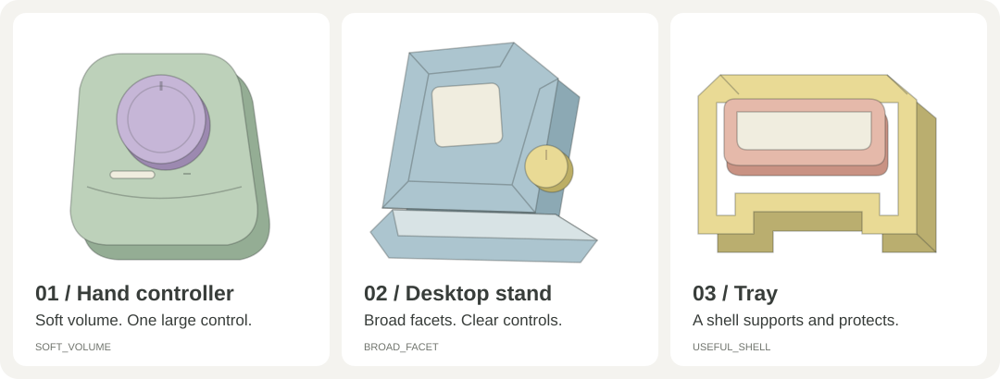
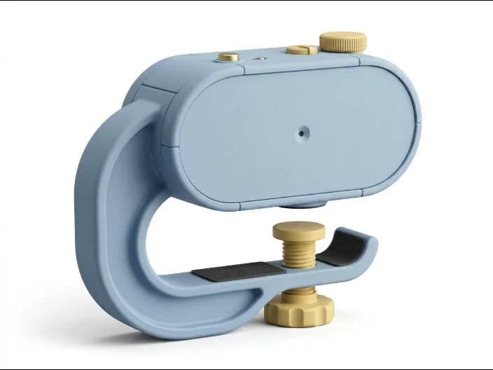
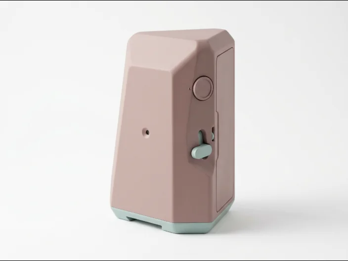
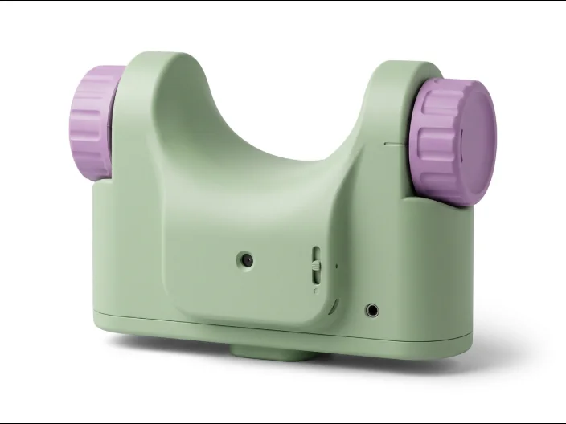
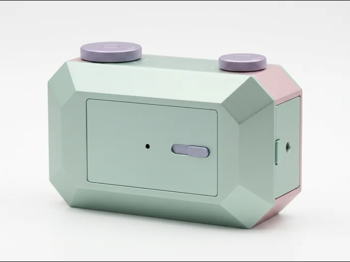
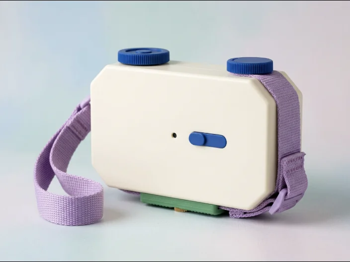
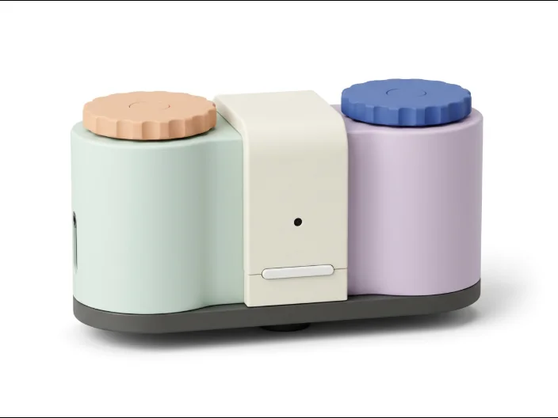

# Mosey — friendly tools with sculptural form

**Mosey 0.1** combines a clear silhouette with large, tactile controls and calm colour fields. A recess, bail, broad facet or folded shell gives an object character while supporting its use.

The [CAD profile](../../profiles/design-language/mosey.yaml) translates this idea into reusable rules. The illustrations below show our interpretation applied to other objects.

Original vector illustration, not to scale. **Hand controller:** a calm body and one large rotary control. **Desktop stand:** a few broad facets and a distinct adjuster. **Tray:** a supporting shell also forms the foot and grip space. These drawings explain the design language; they have not yet been developed into CAD parts or verified mechanisms.

## What the reference actually establishes

When retrieved on 10 September 2026, the [Mosey gallery](https://mosey.camera/) contained 88 form studies in six sections. The site identifies them as AI-assisted concepts, with dimensions and mechanisms still in development. This interpretation examined 18 representative renders across all six sections and preserved the original images with provenance and SHA-256 hashes.

We adopt a visual grammar. Stated target dimensions, depicted materials and suggested mechanisms are not measurements or manufacturing evidence. The profile is our interpretation of the references, not an official specification from the website.

| Observation in the studies | Derived rule for our framework |
| --- | --- |
| Large, calm volumes; the outline remains recognisable without details | Establish the silhouette first, then seams, labels and small edges |
| Rounded bodies sit alongside faceted and folded forms | Three deliberately selectable form variants rather than a universal rounding filter |
| Wheels, levers, recesses and bails visibly shape handling | One useful, characteristic detail per design; its movement or use must be plausible |
| Pastel surfaces, occasional strong blue, dark contacts or visible metal | Assign colours to body, controls and support; specify actual materials separately |
| Few labels and small decorative parts | Use functional marks sparingly; typography and labelling rules are our additions |

## Six references to inspect

### Clamp — the body serves a second purpose

The bracket makes the relationship between enclosure and mounting immediately visible. Our interpretation: a mount or grip may define the main form. Its section, thread and clamping force still require independent mechanical design. [Original Clamp study](https://mosey.camera/#p4-07-clamp).

### Cairn — distinct planes instead of rounding every surface

A few large planes and a distinct foot create a calm body. Our interpretation: broad facets are an equally valid Mosey variant. The form may respond asymmetrically to grip and control travel. [Original Cairn study](https://mosey.camera/#p5-02-cairn).

### Saddle — negative space shapes the object

The recess contributes to the silhouette and provides hand contact between the wheels. Our interpretation: generous, useful negative space can carry more identity than applied decoration. [Original Saddle study](https://mosey.camera/#p6-01-saddle).

### Chamfer — broad facets, quiet details

The scale difference between broad exterior facets and small openings keeps the form readable. Our interpretation: main form, hand contacts and technical details operate at different scales. [Original Chamfer study](https://mosey.camera/#p7-04-chamfer).

### Sling — a soft addition to a solid core

Strap and body remain distinct elements. Our interpretation: textile or elastic contacts can complement a calm base form; their attachment belongs to the mechanical design. [Original Sling study](https://mosey.camera/#p8-02-sling).

### Duo — colour can express roles

This study has more colour fields than the calmer examples. Our interpretation: three designed colour roles are a useful starting point, not a claimed law of the reference. Additional colours need an understandable purpose. [Original Duo study](https://mosey.camera/#p9-08-duo).

Other studies examined include Sweep, Stone, Plinth, Bail, Flute, Crease, Mantle, Lentil, Dock, Dial, Crown and Toggle. The [source manifest](../../provenance/references/mosey/manifest.json) lists all 18 original images with their direct sources.

## Three form variants, one shared language

| Variant | Form rule | Suitable applications |
| --- | --- | --- |
| `soft_volume` | Large bulges or lobes, a calm front, one grip recess or waist | Hand controllers, compact instruments, small enclosures |
| `broad_facet` | A few broad facets, a clear base, softer hand contacts | Mounts, desktop devices, portable instruments |
| `useful_shell` | An open frame, mantle or cradle helps support, protect or hold | Trays, docks, clamps and carriers |

Select the variant deliberately. The YAML entries describe intent for a designer or agent; the existing helpers do not yet generate parametric form variants from them.

## Palette and colour roles

The proposed screen colours are **visual approximations**, not material colours measured from the images. No RAL, Pantone or filament mapping exists yet.

| Colour | Proposal | Use |
| --- | --- | --- |
| Mist blue | `#ACC5CF` | calm main body |
| Sage | `#BDD1BA` | main body or distinct support |
| Lilac | `#C6B6D7` | body, wheel or grip |
| Blush | `#E5B9AA` | body or tactile accent |
| Butter yellow | `#E9DA95` | grip, wheel or supporting shell |
| Chalk | `#F0EDDF` | calm body or connecting surface |
| Cobalt / Cocoa | `#455D9A` / `#65524A` | stronger control contrast where needed |

For a new project, first choose **one body colour, one control colour and, if needed, one support colour**. Keep their meanings consistent within that project. Yellow does not automatically mean shutter, danger or a particular movement direction. Shape, position or a readable symbol supplements colour.

## A concrete starting point in CAD

The following values are our proposed starting points for new handheld objects with a main dimension of approximately 100–180 mm. They were not measured from the renders.

| Element | Proposal | Scope |
| --- | --- | --- |
| Large plan-view corners | R12 mm | starting point for the soft variant; protect existing interior space |
| Hand contact edge | R2 mm | selected free exterior edges |
| Local cosmetic radii | 1 / 2 / 4 / 8 / 12 mm | small transitions; no limit on main curves or mating surfaces |
| Broad form facet | 8 mm | design proposal; no permission to cut away existing reserved space |
| Quiet shadow seam | 0.6 × 0.4 mm | cosmetic only; neither fit clearance nor a sealing dimension |
| New rotary control | Ø28 × 7 mm | hand coupon; determine shaft, force and clearance separately |
| Functional label | 4 mm actual glyph height | readability target; process and testing determine implementation |

Wall thickness, ribs, screws, inserts, print orientation, fits and seals remain in the manufacturing or interface profile. Even a substantial-looking clamp can be weak across its layers. Style radii do not automatically change load paths or hole positions.

## Application and verification

1. Record function, purchased parts, assembly and protected surfaces.
2. Choose a form variant and one useful main detail.
3. Shape free exterior surfaces; assign colour roles and calm parting lines.
4. Apply radii and labels only to named cosmetic regions.
5. Check mechanics and manufacturability against the actual process. Preserve raw findings and classify their significance.
6. Produce colour chips and an appropriate hand or functional coupon before treating values as calibrated.

The existing STEP checker detects radii but does not automatically know their visual or functional roles. A radius outside the family is initially a finding to classify. The generic style-tile generator also represents neither the three form variants nor verified Mosey mechanics.

A suitable instruction is: “Use Mosey 0.1 in the `broad_facet` variant. Preserve the specified interfaces and load paths. Shape the free enclosure surfaces with a few broad facets, one large adjuster and the roles Chalk / Cobalt / Lilac. Document deviations and check against the actual manufacturing profile.”

## What should make the design recognisable

The silhouette remains understandable without colour. The characteristic detail helps the user. Colour fields follow clear roles. Seams and labels do not dominate the main form. Visible metal parts may remain metal; vents, screws or a camera opening are added only when function requires them.

A standard pastel box alone does not fully express this language. Nor does adding as many flower-shaped knobs, arches and grooves as possible. Its identity comes from the combination of **calm form, tactile controls and one useful design idea**.
