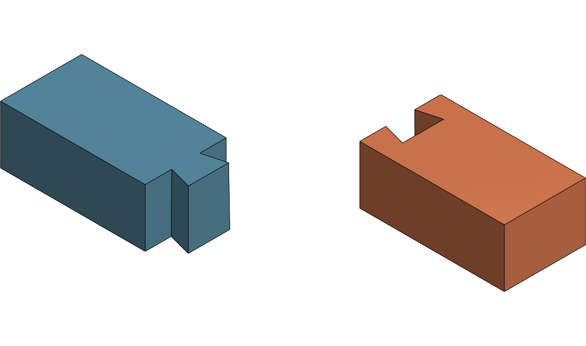
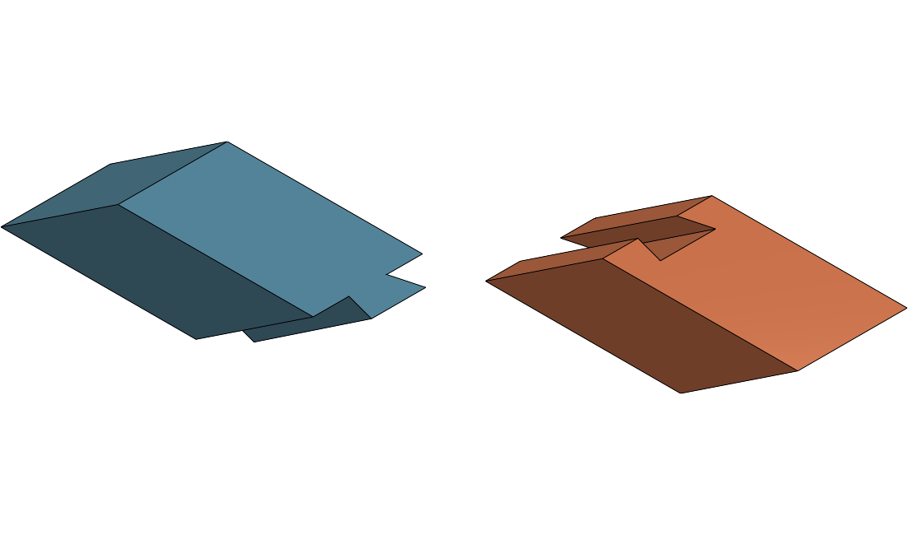
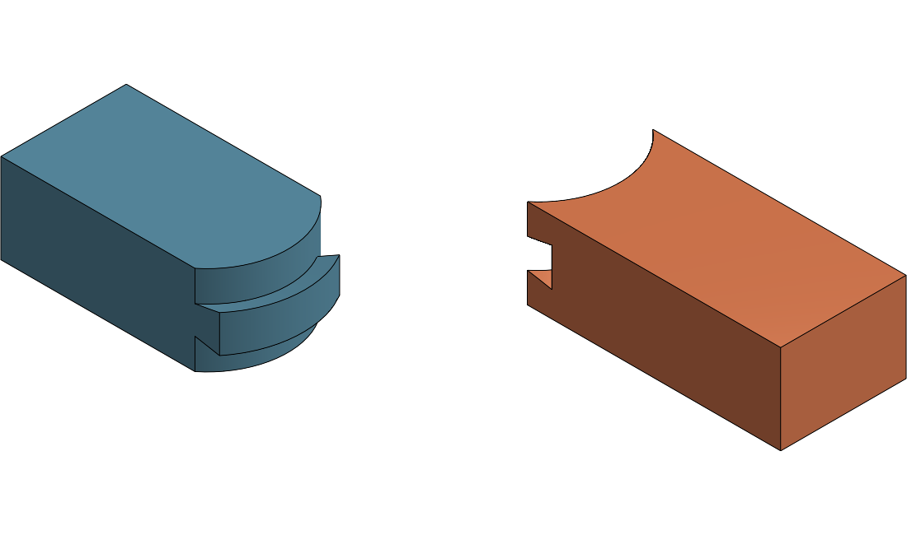
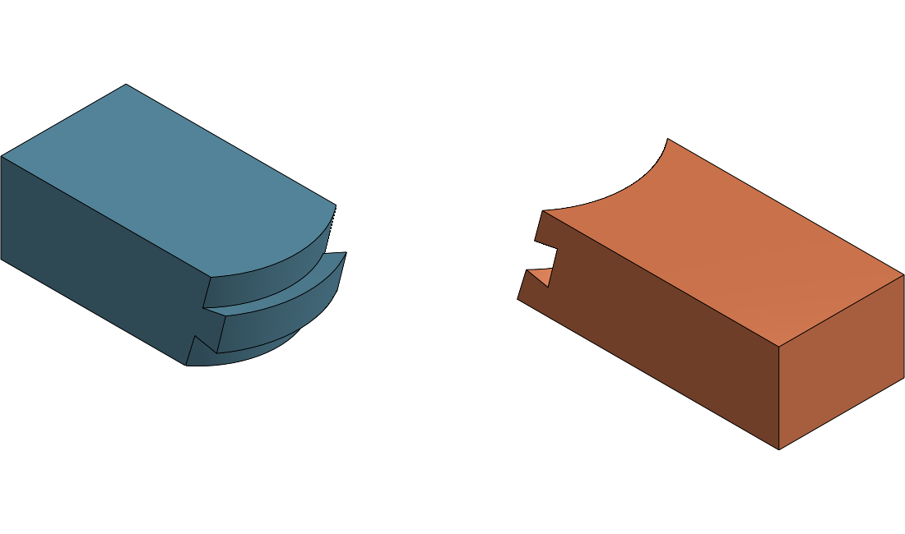
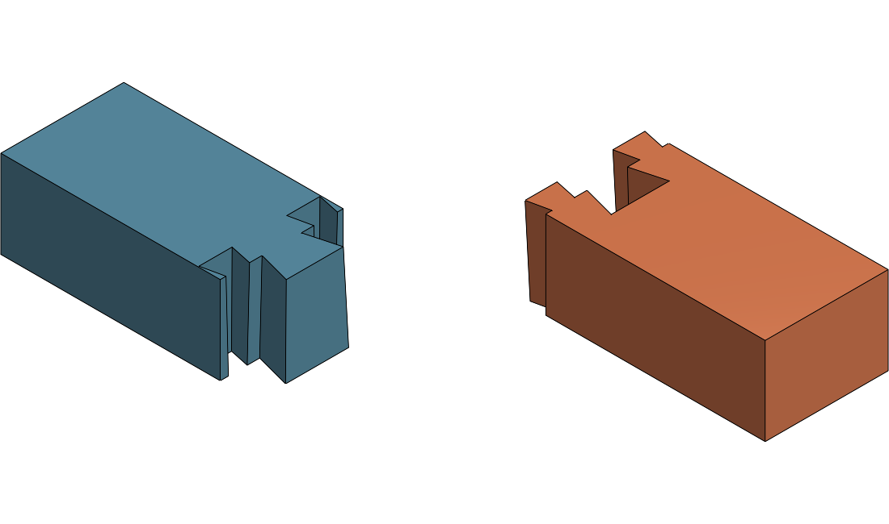
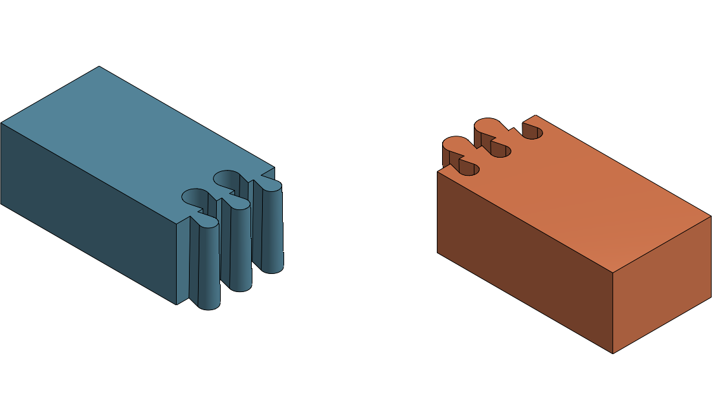
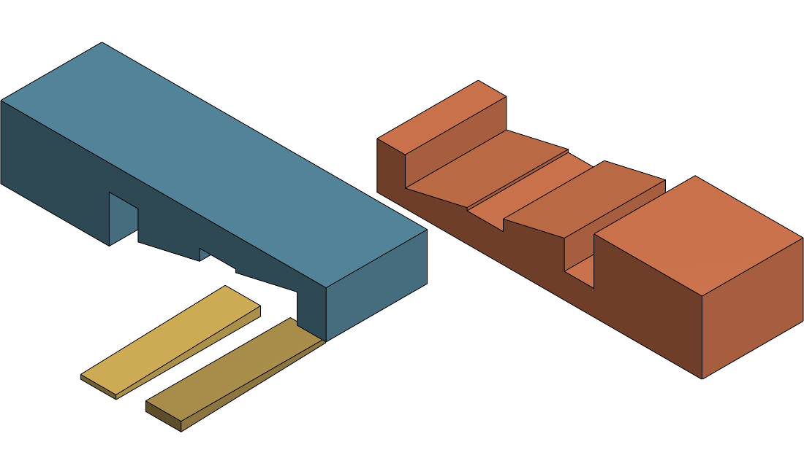

# Printed Joints Lab — eight native joint principles

The three NeedItMakeIt videos provide the starting point for our collection of **eight parametric teaching models**. Each model is available in Onshape in assembled and separated views. Blue identifies partner A, orange partner B; ochre identifies the two additional wedges. These colours describe roles, not verified materials.

[Open the Onshape document](https://cad.onshape.com/documents/e9f4df9ee8ab9bb13f4c372b/v/6c1ed95a6e2e632392788108/e/e4ce629a61cba42a392cecf8). The study uses the transcripts and selected CAD and assembly frames from the three sources; the original Fusion files were not reused. Our models explain the principles using a shared set of dimensions. They are not dimensionally identical copies and have not been approved for a specific load.

## The shared basis

X runs along the bar, Y across its width, and Z through its thickness. Most variants start at 100 × 28 × 20 mm. The shear in J03 also changes the end faces; J08 is 120 mm long. The feature exposes **joint number, nominal profile offset and separated view**. Geometry parameters such as radii and angles are in the readable FeatureScript.

The default **0.10 mm** is a geometric starting point, not a calibrated print setting. In the straight variants, the female profile is expanded in the sketch section; the curved variants combine radial body clearance with the profile offset. The keyed scarf accounts separately for scarf faces, wedge dimensions and channel dimensions. The nominal value therefore does not describe a uniform three-dimensional normal gap everywhere.

The separated views reveal the shapes. They are neither the simulated assembly paths nor final print orientations. Sharp roots and missing lead-in chamfers require deliberate revision before a loaded application, while preserving the protected interlocking geometry.

## The eight variants

### J01 · Straight dovetail


J01 interlocks across the Z sliding direction. The joint remains free along Z; a product may need a stop or an additional retainer on that axis.

**Construction:** Flanks approximately 15°, engagement 8 mm; constant profile over a height of 20 mm. **Assembly:** Insert A from below along +Z.

**Limits of this reconstruction:** No protection against sliding out along Z; thin socket cheeks may spread.

[Native geometry in Onshape](https://cad.onshape.com/documents/e9f4df9ee8ab9bb13f4c372b/v/6c1ed95a6e2e632392788108/e/0006b1a71e89579b058dbede) · [Download STEP](exports/J01-assembled.step) · [Video timestamp](https://www.youtube.com/watch?v=zI8OgRRF5d8&t=90s)

### J02 · Tapered dovetail



The side faces taper along the assembly path. The smaller section enters first; further insertion reduces the available clearance. Preload and self-locking can only be assessed with actual contact and friction.

**Construction:** As J01, with an additional 0.5° profile taper. **Assembly:** Insert A from below along +Z.

**Limits of this reconstruction:** A print that is too tight may jam before reaching its final position; one that is too loose produces no preload.

[Native geometry in Onshape](https://cad.onshape.com/documents/e9f4df9ee8ab9bb13f4c372b/v/6c1ed95a6e2e632392788108/e/013cfb751d89536fa3237cfb) · [Download STEP](exports/J02-assembled.step) · [Video timestamp](https://www.youtube.com/watch?v=zI8OgRRF5d8&t=145s)

### J03 · Scarf dovetail



A shared shear transformation inclines the parting face and the slider. Both partners remain derived from the same master; drawing two separate inclined profiles would be more prone to error.

**Construction:** J02 with an X shear of 1.5·Z, centred about the midplane; the outer end faces are also inclined. **Assembly:** Insert A along (1.5·ΔZ, 0, ΔZ).

**Limits of this reconstruction:** An independent variant, not a dimensionally identical reconstruction of the original scarf. Print orientation and inclined end faces require separate consideration.

[Native geometry in Onshape](https://cad.onshape.com/documents/e9f4df9ee8ab9bb13f4c372b/v/6c1ed95a6e2e632392788108/e/c856fe7d119ea93f30fd75a3) · [Download STEP](exports/J03-assembled.step) · [Video timestamp](https://www.youtube.com/watch?v=zI8OgRRF5d8&t=200s)

### J04 · Curved dovetail



The guide follows a circular arc. A straight pulling movement meets the undercut; assembly and removal require a defined rotation. The surrounding geometry limits the sweep clearance.

**Construction:** Base radius 18 mm; 13 loft sections; 0.5° profile taper along the arc; end stop. **Assembly:** Rotate A to −77°, approach from the left, then rotate to 0° about Z at (−18, 0).

**Limits of this reconstruction:** Rotating as far as −110° causes a collision. The permitted approach is checked separately from the rotation alone.

[Native geometry in Onshape](https://cad.onshape.com/documents/e9f4df9ee8ab9bb13f4c372b/v/6c1ed95a6e2e632392788108/e/1fbced9c4c32094f0219ca88) · [Download STEP](exports/J04-assembled.step) · [Video timestamp](https://www.youtube.com/watch?v=zI8OgRRF5d8&t=295s)

### J05 · Conical curved dovetail



In addition to the curved guide, the base radius changes over the height. This creates more complex contact surfaces in three dimensions. The example demonstrates the modelling method; it establishes no strength advantage.

**Construction:** Bottom radius 18 mm, top radius 22 mm; mean radius 20 mm; the same taper along the arc as J04. **Assembly:** Rotate A to −77°, approach from the left, then rotate to 0° about Z at (−20, 0).

**Limits of this reconstruction:** More complex printing and fit checks; the source video also treats this form as an experiment.

[Native geometry in Onshape](https://cad.onshape.com/documents/e9f4df9ee8ab9bb13f4c372b/v/6c1ed95a6e2e632392788108/e/8d882151bd17f30daaf1244d) · [Download STEP](exports/J05-assembled.step) · [Video timestamp](https://www.youtube.com/watch?v=zI8OgRRF5d8&t=528s)

### J06 · Echo-Lock principle



A central dovetail is accompanied by two flanks that engage in the opposite direction. Their purpose is to geometrically limit socket opening. Actual load sharing depends on fit and stiffness; it is not automatically uniform.

**Construction:** Central taper +1.5°; the two opposing flanks −1.5°; a shared assembly path. **Assembly:** Insert A from below along +Z.

**Limits of this reconstruction:** More undercuts also create more thin roots. A comparative load test remains outstanding.

[Native geometry in Onshape](https://cad.onshape.com/documents/e9f4df9ee8ab9bb13f4c372b/v/6c1ed95a6e2e632392788108/e/e4ce629a61cba42a392cecf8) · [Download STEP](exports/J06-assembled.step) · [Video timestamp](https://www.youtube.com/watch?v=WY8yd191qVE&t=284s)

### J07 · Drop-Lock principle



Three fingers on A and two on B interleave. Their heads use true circular arcs with tangent flanks. Opposing tapers allow a shared insertion path.

**Construction:** Bottom head radius 2.4 mm; spacing between fingers on the same side 9 mm; draft +1°/−1°. **Assembly:** Insert A from below along +Z.

**Limits of this reconstruction:** An independent straight teaching variant; the later inclined development in the video is not included. Finger roots remain critical.

[Native geometry in Onshape](https://cad.onshape.com/documents/e9f4df9ee8ab9bb13f4c372b/v/6c1ed95a6e2e632392788108/e/07327da1691694e39f624c40) · [Download STEP](exports/J07-assembled.step) · [Video timestamp](https://www.youtube.com/watch?v=WY8yd191qVE&t=433s)

### J08 · Stopped scarf with opposing wedges



The two bar ends interlock through steps and a long inclined face. Two printed wedges, oriented in opposite directions, sit in a shared transverse channel. Sliding them against each other can fill the available space.

**Construction:** Four bodies; bar 120 × 28 × 20 mm; two 40 mm wedges at 2°; defined scarf and wedge clearances. **Assembly:** Join A and B sideways, then insert the wedges. To release, push the lower wedge along +Y and the upper wedge along −Y.

**Limits of this reconstruction:** A deliberately simplified straight scarf section: the 45° plane and centring cones from the video are absent. Without additional lateral guidance, Y retention is not secured. The modelled final position includes clearance and does not represent measured preload.

[Native geometry in Onshape](https://cad.onshape.com/documents/e9f4df9ee8ab9bb13f4c372b/v/6c1ed95a6e2e632392788108/e/eb0657ef8e8f8cf92322b497) · [Download STEP](exports/J08-assembled.step) · [Video timestamp](https://www.youtube.com/watch?v=fSISiR5XIbk&t=428s)

## Checking geometry and assembly paths

Results are recorded in the [verification report](verification.json). The checks use native STEP exports: valid closed solids, expected body count, overlap volume in the final position, and discrete assembly paths. An intentionally incorrect pull of A by 1 mm along −X must engage the undercut. This also checks whether the intersection test can detect engagement.

For the curved variants, the complete path starts with a part rotated to −77° and approaching the guide from 50 mm to the left. It then rotates into place at 0°. The initial assumption of a free sweep to −110° was wrong: the outer bar contours collide. The [path selection findings](path-findings.json) record this limit. A final-position check alone would have missed it.

Samples are spaced at 1 mm or 1°; J03 uses a coupled X/Z movement. The volume threshold is 0.00001 mm³. No continuous collision guarantee is claimed between samples. Surface roughness, elasticity, friction and manufacturing errors are outside this geometric check.

**Physical status:** not yet printed, fit not measured, no assembly-force measurement and no load test. The next practical step is a small clearance series in the intended material and print orientation. Selection guidance, coupon rules and the interpretation of the video experiments are in [Joints: construction knowledge](../../knowledge/joints.md).

## Files and rebuilding

- [FeatureScript](joints.fs): the native construction, with no imported meshes.
- [Onshape helper](onshape.mjs): separate commands for source, build, inspection, rendering and export; exclusively through the existing local session bridge.
- [Geometry verification](verify.py): repeatable STEP and assembly checks with OpenCascade.
- [Native revision and artefacts](native-manifest.json): document, elements, source revision, and hashes of exports and renders.
- [Source record](sources.json): original titles, creator, dates and local analysis basis.

```sh
uv run python examples/printed-joints/verify.py
```

The local verification command does not require Onshape access. Live commands in the Onshape helper require the configured session bridge and existing local document state. `create` creates a new public example document; `build` changes its native models. Live commands therefore do not belong in the documentation build. The state directory `var/joints/` is not published; it is created locally for a new lab.

## Further references: panels and elastic clips

The [additional reference review](../../docs/joints/additional-references.md) examines four more videos covering thin panel seams, separate connectors and accessible rim clips. Their compliant assembly behaviour requires evidence beyond the rigid path checks used for J01–J08. These references have not yet been reconstructed as native models.
