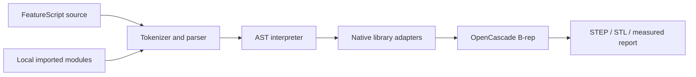

# Architecture

`syntax.py` constructs an AST with source locations. It uses recursive descent
for declarations/statements and a Pratt parser for expressions. There is no host
language evaluation or source-to-Python/JavaScript string replacement.

`values.py` defines persistent containers, shared boxes, immutable vectors and IDs,
tagged values, and dimensioned quantities. SI arithmetic is independent of the
kernel's millimeter coordinate convention. `runtime.py` implements scopes,
calls/overloads, preconditions, control flow, imports and native bindings.
Container assignment reconstructs only the changed path; unchanged arrays/maps
are shared. This preserves FeatureScript value semantics without recursively
copying accumulated geometry-data arrays on every read.

`kernel.py` owns Context, Sketch, Query, body identity and geometry operations.
Operations validate all definition keys before acting. Solid-operation wrappers
snapshot context bookkeeping and commit only valid results. Body records refer
to OCP shapes; transformations copy geometry. Failed solid operations are recorded
even when script-level exception handlers recover. This is operation rollback, not a
complete transactional implementation of Onshape features or arbitrary user code.

Each solid stores face records with creator IDs and appearance properties.
OCCT operation history propagates these records through supported modifications;
split/merged faces retain their contributing creators. Deep geometry copying is
a separate history stage that preserves identity. Patterns/instances start a
new creator lineage. Evaluated transient face/edge handles still reject stale
body revisions; this layer does not implement Onshape's persistent topology.

History lists are read by their known native size. Profiling found that exhausting
an OCP 7.9 `TopTools_ListOfShape` iterator took about 3 ms even for an empty list;
bounded iteration avoided that exception path. In diagnostic runs the hot-wire
model dropped from 32.09 to 0.71 seconds with identical measured geometry and
lineage. Those runs had different concurrent workloads, so these timings are
diagnostic observations, not a controlled performance benchmark.

Booleans use non-destructive OCCT construction. Optional same-domain unification
runs on a deep copy because OCCT 7.9 can mutate its input while producing an
invalid simplified shape. A failed validity check retains the raw valid boolean.
The captured channel-base fixture tests this behavior and operand preservation.

Disconnected union outputs are attributed using source-body keys propagated
with the face history. A captured R10b fixture demonstrates why re-intersecting
an exact copied output with its input is unreliable: OCCT can report an empty
Common. Only fully enclosed inputs without surviving boundary faces require
the geometric attribution fallback. Missing contributors fail explicitly.

STEP export stages a file, reads it back and verifies all solids and volume/bounds
tolerances before replacing the destination. If a valid trimmed periodic face
becomes unorientable during transfer, the exporter locates its source solid by
volume and bounds, requiring a unique match. It splits closed faces only on a
deep copy of that solid and retries once. Other bodies and the original context
remain unchanged. The toroidal hot-wire ring fixture exercises this path.

`partstudio.py` freezes named STEP roots into hash-checked B-rep manifests and
loads them as modules exporting `build({})`. These contexts can be instantiated
with explicit part queries and transforms. The imported geometry is fixed;
configuration changes require a different captured dependency.

`api.py` exposes `run` and `Build`. `cli.py` parses source selection, parameter
expressions, local import mappings and output options. Reports record input
source hashes, backend version, execution statistics, actual solid counts,
volumes, bounding boxes and validity. Generated geometry belongs in `output/`.
`corpus.py` verifies source hashes and runs selected cases in isolated processes
with wall-clock limits, retaining incremental summaries, reports and logs.
Successful recovery from a failed native operation is reported separately from
an error-free execution. Implementation hashes bind measurements to their code.

## Extend the engine

1. Add a source-level fixture using the actual public FeatureScript API. State
   the supported parameter combinations; reject all others explicitly.
2. Add the value/parser/runtime behavior or a kernel adapter. Register native
   bindings in `Engine.builtins` or `kernel.bindings`.
3. For geometry, assert measurable invariants (analytic volume, expected bounds,
   solid count, identity preservation) and relevant failures. For language
   behavior, test a meaningful value-semantics or control-flow distinction.
4. Update the compatibility contract. Preserve ordinary runtime errors as
   catchable `RuntimeErrorFS`; missing behavior uses uncatchable `Unsupported`.

The highest-value next additions are a planar arrangement/constraint solver,
edge/vertex and transient-query history, imported topology provenance, and more
standard-library adapters. Cross-kernel reference comparisons are needed to
assess geometric fidelity beyond valid local solids. Wider language conformance needs
module-local type identity, general map keys, operator overloads, constant
dependency evaluation and a dedicated static/purity checker. Each is a separate
engineering task; silently skipping those semantics would undermine CAD results.
