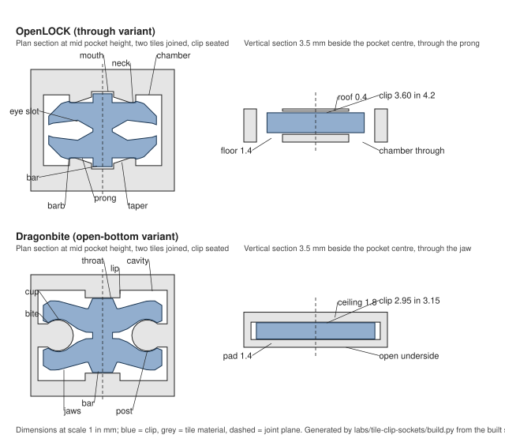

# Tile clip joints: OpenLOCK, what DragonLock taught, and a merged design

A tile clip joint connects two flat-edged tiles with one small separate clip. Each tile carries an identical pocket in its edge; the clip is pushed into both. The pattern comes from 3D-printed dungeon terrain, where OpenLOCK (Printable Scenery) and DragonLock with its Dragonbite clip (Fat Dragon Games) have enough public geometry to learn from. This article records OpenLOCK in full, because its port is the open base we build on. It keeps DragonLock to the three principles we borrow, because its geometry is not open. It then shows how to model such a pocket in any CAD, how the joint scales, how to derive the matching clip, and proposes a merged design that stays OpenLOCK-compatible.

Everything here is read from documents or measured on downloaded meshes. Nothing in this repository has been printed or fitted. Every dimension carries its source in brackets: [OL] for the OpenLOCK findings, [DL] for the DRAGONLOCK findings, [CMP] for the comparables survey. Values we calculated are marked "derived"; values we suggest are marked "proposed". Provenance: [`provenance/references/tile-clips/manifest.json`](../../provenance/references/tile-clips/manifest.json). Reproducible geometry: the [tile-clip-sockets lab](../../labs/tile-clip-sockets/README.md), with a build123d generator `build.py` (`--scale` option), a `Process` floor model, exports and a results summary.

## What a clip-in-pocket joint is

One clip, two identical pockets. The clip is symmetric about its centre. Its bar sits across the joint line, half in each tile's mouth. Behind each mouth the pocket narrows to a neck and widens into a chamber. The clip ends carry barbs (OpenLOCK) or jaws (Dragonbite) that pass the neck under compliance and expand again in the chamber: "the clip wedges inside a 2 anchor points inside a port to keep locked in place" [OL: PS-OS, Sam Campbell comment].

The three joint effects from [Joints](joints.md) map onto this joint as follows.

| Effect | Where it happens in a clip joint |
| --- | --- |
| Geometric interlocking across the joint | The bar fills both mouths. Shear along the edge and vertical offset are blocked by the bar in the mouth and the clip body in the pocket. |
| Retention along the joint | OpenLOCK: barbs behind the neck. Dragonbite: jaws closed around a post head. Both resist pulling the tiles apart. |
| Friction and preload | OpenLOCK: prongs squeezed by the neck press outward; leftover support nodules "can often provide some extra resistance" [OL: PS-SUP]. Dragonbite: the jaws spread about 0.5 mm each over the post head [DL: MEAS, inferred]. |

The joint is good at in-plane location and pull-apart retention. It is weak against peeling: the clip is a thin plate loaded across its layers when one tile is lifted. It has vertical play equal to pocket height minus clip thickness: 0.6 to 0.7 mm in OpenLOCK [OL: lock_openlock.scad L7; PS-MEAS-3, derived] and about 0.12 mm in Dragonbite [DL: DLU_2x2_Master.stl measured, derived]. A reviewer found Dragonbite v2 "a bit wobblier than OpenLOCK" [OL: BILL].

## Glossary

The drawing is generated from the lab's own scale-1 geometry, not traced from either vendor's files [lab: build.py].

| Term | Meaning |
| --- | --- |
| Contact face | The tile edge face that two tiles touch. |
| Mouth, throat | The opening in the contact face. |
| Taper | The narrowing section behind the mouth. |
| Neck | The narrowest passage. |
| Chamber, anchor | The widened space behind the neck where barbs or jaws expand. |
| Bar | The clip's central web that bridges the two mouths. |
| Prongs | OpenLOCK: the two parallel arms on each clip end. |
| Jaws | Dragonbite: the two splayed arms on each clip end. |
| Barb | The bulge on an OpenLOCK prong that anchors behind the neck. |
| Eye slot | The compliance slot between OpenLOCK prongs. |
| Post | The Dragonbite tongue inside the cavity, with a round head. |
| Lying pocket | Horizontal pocket in a floor tile side; the clip lies flat. |
| Standing pocket | Vertical pocket in a wall end; the clip stands upright. |
| Through-pocket | A wall pocket open on both faces. |
| Rim | The guaranteed solid material around a mouth. |
| Roof | Material above the pocket. |
| Floor | Material below the pocket. |
| Open-bottom pocket | A pocket with no floor, open to the tile underside. |

## OpenLOCK

**Grid and module.** "OpenLOCK is based on the 1″ Dungeon tile to allow a 25mm base to fit within a 1″ square" [OL: PS-DEV]: 25.4 mm squares, 50.8 mm standard tiles, 12.7 mm half module. Standard wall height 50.8 mm, half 25.4 mm [OL: PS-DEV]; walls 12.7 mm thick, corner posts 12.7 × 12.7 [OL: PS-OL1]. Floor bases are 6 mm high [OL: OpenForge bases.scad; hadencain terrain.ts L16; OpenVLex README L172]. One port every 12.7 mm along an edge, at each inch-square centre and each square boundary, corners excluded [OL: OpenForge impl_square.scad L9-39; PieterVdc floor_maker.py L292-301].

**Socket geometry.** No official dimensioned drawing exists and the STL templates were not obtained [OL: §7]. The values come from OpenForge's OpenSCAD, which Printable Scenery credits [OL: PS-DEV], corroborated by two re-implementations [OL: CAIT; PVDC]. Frame: x is depth from the contact face, y along the edge, z up from the tile bottom.

| Feature | Value | Source |
| --- | --- | --- |
| Mouth width × depth | 14.0 wide, 2.0 deep | [OL: OpenForge lock_openlock.scad L7; CAIT; PVDC] |
| Pocket z band | z 1.4 to 5.6, height 4.2 | [OL: lock_openlock.scad L7-15; CAIT; PVDC] |
| Floor and roof in a 6 mm base | 1.4 below, 0.4 above | [OL: §7.1, inferred] |
| Taper | 12.0 wide at x 0 to 2, hulled to 10.0 wide at x 3.01 to 5.01 | [OL: lock_openlock.scad L8-11] |
| Neck | 10.0 wide, x 5 to 6; height 4.2, rising to 4.7 at x 6 to 7 | [OL: lock_openlock.scad L12-15] |
| Chamber | 12.8 wide, x 6.0 to 10.7, z −1 to 6.1 (through the base top and bottom) | [OL: lock_openlock.scad L16] |
| Total depth | 10.7 | [OL: lock_openlock.scad L16] |
| Support bars | Two 1.0 mm bars at y ±2.05 to 3.05, x −1.1 to 2.0, z 1.2 to 5.8 | [OL: lock_openlock.scad L19-35; PVDC] |
| Rim (positive) | 16 wide × 2.0 deep × 5.6 high at z 0.4 | [OL: lock_openlock.scad L38] |
| Pitch | 12.7 | [OL: OpenForge bases.scad L251-284; PVDC] |
| Mouth chamfer | None in OpenForge; official tiles unconfirmed | [OL: OF-LOCK] |
| Wall thickness around ports | Not specified by any source | [OL: §7.1] |

**Clips.** The current official standard clip is v5.4, bounding box 13.2 × 19.5 × 3.5 mm [OL: PS-MEAS-3]; its STL was not obtained. Older official clips vendored by OpenForge were measured. They carry a mid-height groove assumed to be a wire channel for OpenForge's powered tiles; the outline below is from the unaffected z 0.6 section [OL: §6 caveat, inferred].

| Feature | v4.3 value | Source |
| --- | --- | --- |
| Overall W × L × T | 14.0 × 19.5 × 3.6 | [OL: MEAS extents] |
| Bar | Full 14.0 width, y ±1.725 (3.45 long) | [OL: MEAS runs] |
| Prong width | 10.0 (x ±5.0) from y 1.775 to 5.675 | [OL: MEAS runs] |
| Barb | 10.40 max at y 6.0 to 6.25 | [OL: session section] |
| Taper behind barb | 9.98 at y 7.0, 8.6 at 8.0, 7.6 at 8.5, about 45° | [OL: session section] |
| Tip | 6.6 wide at y 9.0, ends at y 9.75 | [OL: session section z 0.6] |
| Eye slot | 0.53 at y 1.75, widest 3.64 at y about 4.5, 2.0 at the tip | [OL: session section] |
| Thickness | 3.6 | [OL: MEAS bbox] |

From v4.3 to v5.4 the width dropped 14.0 to 13.2 and the thickness 3.6 to 3.5; the length stayed 19.5 [OL: §6, inferred from the two measurements].

**How it engages** [OL: §7.1, inferred]. The clip half-length of 9.75 sits inside the 10.7 deep pocket. The 10.0 prongs pass the 10.0 neck line to line, squeezed via the eye slot. The 10.4 barbs expand behind the neck in the 12.8 chamber. The bar bridges the two 2 mm mouths. Vertical play is 4.2 minus 3.5 to 3.6.

**Placement.** Floors: one pocket per 12.7 mm on every edge, in z 1.4 to 5.6 of the 6 mm base [OL: §8]; for large tiles "we recommend using two OpenLOCK clips per join if possible" [OL: PS-CITY]. Walls: the same pockets in the base band, three per 50.8 mm wall [OL: PS-TOP, inferred]; vertical side-locking pockets on wall ends and columns since v5.0, "set for half-height and full-height walls" [OL: PS-DEV]. Corners: "One clip on either side; you should not need two clips" [OL: PS-F-first_build]. Stacking uses top-locking pins, not clips [OL: PS-WHAT].

**Versions and compatibility.** Template v4.0 removed 1 mm from the clip corners so four clips fit an I tile; v5.0 added side locking; template 7.8 moved the clip to 5.3 and 8.2 (2018-09-10) to 5.4; the pack is now 8.6 [OL: PS-TPL]. A v5.5 PassThru clip for columns followed on 2025-08-22 [OL: PS-CLIPS]. "OpenLOCK is always backwards compatible" [OL: PS-SHEET] and "the location of the OpenLOCK ports must never alter" [OL: PS-DEV]. Whether pre-4.0 sockets accept 5.4 clips exactly is unconfirmed; the clip envelope only shrank, which loosens old ports rather than jamming them [OL: §4].

**Licence.** The system files are Creative Commons Attribution-NonCommercial 4.0 with attribution to www.printablescenery.com; free distribution of compatible tiles is allowed [OL: PS-OS]. Selling needs a commercial licence that is "absolutely free, never expires, and is exclusive to the designer", with the OpenLOCK Compatible logo and a link back [OL: PS-LIC; PS-FORUM-LIC]. The issued licence converts the CC terms to a BSD-style licence for that licensee [OL: PS-BSD]. Only the system files are open; Printable Scenery's own tile designs are not [OL: PS-OS].

## What DragonLock contributes

**Why we do not build on it.** The Dragonbite geometry is not open. The compatibility licence is granted by application and has no public text, and Community Creator products may not ship clips [DL: FDG-LIC; FDG-COMPAT; DTRPG-CC]. The standalone clip STL was not obtained; every clip number below is measured on the DragonLock half of FDG's own combo clip [DL: §3 caveat]. DragonLock also places one socket per edge and none at wall ends [DL: MEAS], which is why "large rooms can flex a bit when lifted" [DL: BB].

**The three principles we take.** First, vertical play of about 0.12 mm instead of 0.7: a 3.08 clip in a 3.2 throat [DL: MEAS]. Second, a round post that the jaws close around; its head self-centres the clip and gives the jaws a target [DL: MEAS; OpenForge lock_dragonlock.scad L83-84]. Third, a cavity open to the underside, so nothing is bridged except the lip [DL: DLU_2x2_Master.stl measured].

The handful of measured values those three principles rest on are below. Everything else that was measured on the DragonLock files stays in the research findings and the provenance manifest.

| Feature | Value | Source |
| --- | --- | --- |
| Throat width × height | 13.65 × 3.2 | [DL: DLU_2x2_Master.stl measured] |
| Clip thickness | 3.08 | [DL: ComboClip-v3.stl measured] |
| Post head diameter | about 5.6 | [DL: DLU_2x2_Master.stl measured] |
| Head centre from edge | about 8.1 | [DL: DLU_2x2_Master.stl measured] |
| Cavity depth | 11.7 | [DL: DLU_2x2_Master.stl measured] |
| Floor | Pad under the post only, open elsewhere | [DL: DLU_2x2_Master.stl measured] |

## Why OpenLOCK is the base

| Item | OpenLOCK | DragonLock |
| --- | --- | --- |
| Openness of the spec | Three independent codebases reproduce the port and agree; compatible tiles may be published freely [OL: OF-LOCK; CAIT; PVDC; PS-OS] | No public geometry spec; compatibility licence by application [DL: FDG-COMPAT] |
| Socket locations | Floor sides, wall bases, wall ends, columns [OL: PS-DEV] | Bases only, one per edge [DL: MEAS] |
| Clip as clearance owner | The pocket is a fixed profile; fit is tuned on the clip [OL: §5] | The same principle: the clip was revised twice, the tiles were not [DL: FDG-V2; FDG-V3] |
| Community clip variants | Springy, tight and flexible clips on the standard outline [OL: PS-REF; PS-F-springy; CMP: third-party OpenLOCK clip variants] | Clips may not ship with Community Creator products [DL: DTRPG-CC] |
| Adapters | Beta OpenLOCK to Dragonlock adapter [OL: PS-ADAPT] | Combo clips to OpenLOCK v3 and InfinityLock v1 [DL: FDG-ADAPT] |

OpenLOCK's spec is effectively open, its ports sit everywhere we need them, its clip already owns every clearance, and a community of clip variants shows that fit problems get solved on the clip side. The commercial licence is free [OL: PS-LIC]. Decision: build inside the OpenLOCK port envelope so official clips and tiles stay compatible.

## Modelling a lying pocket cleanly

This procedure works in Onshape, build123d and Fusion. The bracketed dimensions are OpenLOCK examples; the procedure does not depend on them.

1. **Fix the tile frame.** Contact face at x = 0, x positive into the tile, z = 0 at the tile bottom. Pocket centre on the pitch line (y at 12.7 multiples, corners excluded [OL: OpenForge bases.scad L251-284]).
2. **Draw one profile sketch** of the pocket outline in plan view: mouth, taper, neck, chamber. Add one z band (z 1.4 to 5.6 [OL: lock_openlock.scad L7]). Derive every cut and the clip from this single sketch. This is the shared profile rule from [Joints](joints.md): an independent second sketch introduces unnoticed differences.
3. **Cut in stages.** Mouth: a 14.0 × 2.0 rectangle extended past the face for a clean cut [OL: lock_openlock.scad L7]. Taper: a loft or hull between a 12.0 rectangle at x 0 to 2 and a 10.0 rectangle at x 3.01 to 5.01 [OL: L8-11]. Neck: 10.0 wide, x 5 to 6 [OL: L12-15]. Chamber: 12.8 wide, x 6.0 to 10.7 [OL: L16]. Decide whether the chamber cuts through the base top and bottom, as OpenForge does (z −1 to 6.1 [OL: L16]), or stays blind, as FDG's 2020 port block does (floor 1.4, ceiling 1.37 [DL: Dragonbite_Port.stl measured]). Through means no roof to bridge over the chamber but a visible hole in the tile top and bottom. Blind means a roof that must be bridged or supported. In OpenForge only the chamber is through; mouth, taper and neck keep their 0.4 roof [OL: L7-16]. On a 25.4 mm base with a through chamber on every edge, the four chambers isolate a 4 mm centre square from the rim, so a base-only print falls apart until the tile top closes it; OpenForge's bases rely on the glued or co-printed top for this. The lab flags this as `through_centre_island` [lab: results/scaling-table.md].
4. **Guarantee the rim as a positive body** before texturing: 16 wide × 2 deep × 5.6 high at z 0.4 in OpenForge [OL: lock_openlock.scad L38]. Union it back after the decorative cuts so no texture can break into the pocket.
5. **Choose the roof strategy.** (a) Built-in sacrificial support bars in the mouth, removed with long-nose pliers: two 1.0 mm bars at y ±2.05 to 3.05 [OL: lock_openlock.scad L19-35; PS-SUP]. Only the outer bars go; the dividers between ports stay because "they provide pressure to make the clips hold" [OL: PS-SUP]. (b) An open-bottom pocket: FDG's 2017 tile is open to the underside outside the post pad [DL: DLU_2x2_Master.stl measured]; OpenForge's topless variant removes the bay roof for a glued-on floor [OL: lock_openlock_topless.scad]. (c) A 45-degree or teardrop roof if the base is tall enough. Proposed; neither official geometry does this.
6. **Optional lead-in chamfer** at the mouth edges, 0.3 to 0.5 mm. Proposed; not in either official geometry [OL: OF-LOCK; DL: §4]. It eases insertion and hides elephant foot at the first-layer edge.
7. **Place the pockets** on the pitch, exclude the corners [OL: OpenForge bases.scad L251-284], and add a second pocket per edge on larger tiles [OL: PS-CITY].
8. **Checks.** A plan section at mid-height shows the full profile. Roof at least two layers. Rim at least two perimeters. Pocket floor at least the first-layer allowance. No texture breaks through. Then slice and inspect the bridge over the mouth: with support bars the spans are the gaps between bars; without, it is the full 14 mm. What each check establishes is described in [Verification](../foundations/verification.md); none replaces a printed trial.

## Modelling a standing pocket in walls

**(a) Wall base through-pocket.** For a 12.7 mm wall the OpenForge pocket goes straight through, with a mouth on each face and a shared neck: mouth 14 wide and 2 deep from each face, taper 12 to 10 over 3 mm, neck 10 wide and 4.7 long across the wall centre, z 1.4 to 5.6 [OL: lock_openlock.scad L50-66]. Supports sit at both mouths [OL: L62-63]. The rim is 12.7 × 16 × 5.6 at z 0.4 [OL: L69]. One observation from the lab: if the outer 1 mm of that mouth is only the cut buffer, the mouth inside a 12.7 mm wall is 1.0 mm deep, and a 3.45 mm bar spanning a 1.0 mm wall mouth and a 2.0 mm floor mouth leaves 0.45 mm between the faces. Whether official walls use a full 2 mm mouth is unconfirmed; the lab reports the clash as `wall_through_bar_clash` [lab: results/scaling-table.md; OL: L50-66, inferred]. Thicker walls get the bay mirrored about the wall centre with a shared 12.8 wide chamber [OL: lock_openlock_dual.scad L5-18].

**(b) Vertical side-lock pocket** on wall ends and columns. The same profile rotated 90 degrees so the clip stands upright. Pocket thickness 4.2 (y ±2.1), profile in the x-z plane: mouth 14 tall from x −1 to 2, taper to 10 tall at x 5, 10 tall to x 5.9, chamber 10.52 tall from x 5.9 to 10.43 [OL: lock_openlock.scad L72-78]. Rim 11.43 × 6.2 × 16 [OL: L81]. Pocket thickness equals clip thickness plus play: 3.5 to 3.6 in 4.2. Official positions are half and full height [OL: PS-DEV]; the exact z values are unconfirmed [OL: §7.3]. One pocket on either side of a corner is enough [OL: PS-F-first_build]. OpenForge's side-lock chamber is 10.52 tall rather than 12.8; no source explains why [OL: L72-78].

**(c) Print orientation consequences.** Decide the wall's print pose first, per [Print orientation](../manufacturing/print-orientation.md). A wall printed standing turns the chamber roof of a vertical pocket into a narrow bridge of pocket thickness, 4.2 mm, which is fine; but it turns the base through-pocket's mouth into a bridge of mouth width, 14 mm, which needs the support bars. A wall printed lying on its face turns the vertical pocket's chamber into a 10.52 mm bridge, which needs support or an open side; the base through-pocket then prints as a plan-view profile with no bridge. Community advice: print OpenLOCK walls with a brim, since a warped lower port makes the wall unusable [OL: BILL].

## Scaling the joint

Profile dimensions scale with a factor s: mouth, taper, neck, chamber, clip bar, prongs, barbs and thickness. Process quantities do not scale. They have floors set by nozzle and layer, and those floors are calibration candidates in the sense of [FDM](../manufacturing/fdm.md), not established values.

| Quantity | Rule | Floor (proposed) |
| --- | --- | --- |
| Clearance: pocket height minus clip thickness, mouth minus bar | Scales with s, must stay above the process clearance | 0.15 to 0.2 mm in XY, one layer in Z |
| Barb interference (10.4 barb in a 10.0 neck, 0.2 per side at s = 1 [OL: MEAS v4.3; lock_openlock.scad L12]) | Scales with s | About one line width in total, or engagement becomes unreliable |
| Roof | Scales with s | At least two layers |
| Rim | Scales with s | At least two perimeters |
| Support bars (1.0 mm at s = 1 [OL: lock_openlock.scad L19-35]) | Scale with s | One to two line widths |
| Clip thickness | Scales with s | At least four layers so it prints as a solid bar |

The OpenLOCK budget in a 6 mm base is 1.4 floor + 4.2 pocket + 0.4 roof [OL: §7.1, inferred]. At 0.2 mm layers the roof is exactly two layers at s = 1; any s below 1 falls under two layers (s = 0.9 gives 0.36 mm). At 0.15 mm layers the limit moves to about s = 0.75. When scaling down, either open the bottom of the pocket, or keep the base height and move the pocket down so the roof keeps its two layers. Base height must follow the pocket, not the reverse.

Derived key values (v5.4 clip thickness, v4.3 barb):

| s | Pocket height | Clip thickness | Neck | Barb interference per side | Roof in a scaled 6 mm base | Floors hit (0.2 mm layers, 0.4 mm lines) |
| --- | --- | --- | --- | --- | --- | --- |
| 0.5 | 2.1 | 1.75 | 5.0 | 0.1 | 0.2 | Roof, barb; support bars at one line width |
| 0.75 | 3.15 | 2.63 | 7.5 | 0.15 | 0.3 | Roof, barb |
| 1 | 4.2 | 3.5 | 10.0 | 0.2 | 0.4 | Roof at its limit |
| 1.5 | 6.3 | 5.25 | 15.0 | 0.3 | 0.6 | None |
| 2 | 8.4 | 7.0 | 20.0 | 0.4 | 0.8 | None |

The pattern: scaling down hits the roof first, then barb interference, then the support bars. Rim (2.0 s against two perimeters) and clip thickness are not reached above s = 0.4. Clearances are not binding either: 0.7 s of vertical play stays above one layer down to s about 0.3. Dragonbite differs: its 0.12 mm thickness clearance [DL: MEAS] is already below the proposed XY floor at s = 1, which fits the reports that first-layer squish makes the clip tight [DL: §5, inferred]; that is why the merged design settles at about 0.3 mm instead. The lab computes this table from the generator and its `Process` model; the lab's summary is the maintained table, this one shows the pattern.

**How much stability do I need.** Under geometric similarity the strain in the prongs stays constant, because deflection and prong length scale together. Retention force scales with s squared (section area), stiffness with s. Relative wobble is clearance divided by engagement length; if clearance stays at its floor while engagement grows, wobble falls as s grows. Scaling up is therefore the answer for heavier walls and large multi-tile blocks. Two clips per edge is often cheaper than a bigger clip: it doubles retention without changing the base height, and Printable Scenery already recommends it for large tiles [OL: PS-CITY]. Scaling down is limited by the floors long before it is limited by strength. Printable Scenery's own advice: "scale down by probably 10%" and "as long as you print the OpenLOCK clips at the same scale everything will work fine" [OL: PS-F-choosing_scale]. At 125 percent one user's clip broke the tile; the advice was more infill, a resized clip or the springy clip [OL: PS-F-clips_breaking_terrain]. Both are user reports, not tests.

## Deriving the matching clip

Derive the clip from the same profile sketch as the pocket.

- **Bar length** equals two mouth depths plus the joint gap. OpenLOCK's measured bar is 3.45 long against two 2.0 mouths [OL: MEAS v4.3; lock_openlock.scad L7]; the 0.55 difference is along-joint slack that lets the contact faces close.
- **Bar width** equals mouth width minus clearance. v5.4 went from 14.0 to 13.2 while the mouth stayed 14.0 [OL: PS-MEAS-3; MEAS v4.3; lock_openlock.scad L7]; that 0.8 mm is the only documented clearance change.
- **Prong width** equals neck width, line to line (10.0 in 10.0 [OL: MEAS v4.3; L12]); compliance comes from the eye slot.
- **Barbs** equal neck plus interference (10.4 [OL: MEAS v4.3]), just behind the neck inside the chamber (barb at y 6.0 to 6.25, neck ending at x 6 [OL: MEAS v4.3; L12-15]).
- **Tip chamfer** about 45 degrees for lead-in [OL: session section].
- **Thickness** equals pocket height minus play (3.5 in 4.2 [OL: PS-MEAS-3; L7]).
- **Eye slot width** sets compliance (0.53 at the root, 3.64 widest [OL: MEAS v4.3]); springy variants add slits to the standard outline [OL: PS-REF; PS-F-springy].
- **Post and jaws:** the merged design adds an inner anchor to this outline; see [A merged design](#a-merged-design).

**Clearance ownership.** The clip owns thickness clearance, bar clearance and barb interference. The pocket owns nothing but its profile. Every pocket in every tile stays identical, and a tighter or looser clip fixes a fit without reprinting tiles, which is what the community's springy, tight and flexible clip variants do [OL: §5; CMP: third-party OpenLOCK clip variants].

**Printing the clip.** Print flat, no brim or raft: "little bits of plastic on the edges" ruin the fit [OL: GH-9]. PLA "has some flexibility", resin "would be too brittle" [OL: SAUCER]; OpenForge's author recommends PETG for Dragonbite clips [DL: RD u/devondjones]. FDM only, 15 percent infill, 0.2 mm layers [OL: PS-CLIPS]. Make the clip the sacrificial part, never the tile divider: springy clips are "cheaper to break than tile dividers" [OL: PS-F-springy; CMP: third-party OpenLOCK clip variants].

## A merged design

Everything in this section is proposed and not yet printed. The test package is described in the lab [lab: labs/tile-clip-sockets/print/README.md]; the geometric cross checks against the official clip and the official port are in [lab: results/merged-table.md].

**Envelope.** The OpenLOCK port profile stays unchanged: mouth 14 × 2 at z 1.4 to 5.6, neck 10, chamber 12.8 wide to x 10.7, pitch 12.7 [OL: lock_openlock.scad L7-16]. Official clips fit our tiles, and our clip fits official tiles.

**Socket changes** (proposed).

- Chamber open to the underside, with the tile top as its roof. This is the OpenLOCK Triplex idea [CMP: principles that transfer] plus the DragonLock underside [DL: DLU_2x2_Master.stl measured]. Only the 14 × 2 mouth is bridged, so no sacrificial bars are needed on a current printer.
- A Ø2.0 post at x 8.0 from the contact face, full height. It supports the top plate over the open chamber, self-centres the clip and gives the jaws a target.
- A 0.4 mm lead-in chamfer at the mouth.
- The rim kept as a positive body, 16 × 2 × 5.6 at z 0.4 [OL: lock_openlock.scad L38].
- Vertical side-lock pockets at wall ends, as OpenLOCK does [OL: PS-DEV].

**Clip** (proposed).

- The OpenLOCK outline, 13.2 × 19.5 [OL: PS-MEAS-3], with two anchors: barbs outside behind the neck, jaws inside around the post with a bite narrower than the post.
- Thickness 3.7 to 3.9 instead of 3.5. Vertical play drops from about 0.7 to about 0.3 mm (4.2 minus 3.9; 0.5 at 3.7, derived), peel stiffness rises with the cube of thickness, and the clip stays clear of DragonLock's first-layer squish problem [DL: §5, inferred].
- The clip remains the owner of every clearance. Grip variants come only from barb and bite interference; the pocket never changes.

**Compatibility condition, checked geometrically.** An official clip must pass over the post through its eye slot. With the bar centred on the joint plane, clip station y equals pocket depth x, so the post at x 8.0 sits at clip y 8.0, between the widest slot point (3.64 at y about 4.5) and the 2.54 at y 9 [OL: MEAS v4.3 session section]. The lab seats the measured v4.3 outline in the merged socket and reports a post-to-slot clearance of 0.39 mm per side with no collision, in the floor tile, the wall side-lock pocket and the four cube poses that were checked [lab: results/merged-table.md]. The v5.4 clip was not measured; the condition holds only if its eye slot did not narrow. In the seated pose the bite interference is zero by design: the cup clears the post and the jaws are unloaded, so retention comes from re-spreading on withdrawal, not from sustained preload (derived).

**Relaxation and fatigue (derived).** A seated OpenLOCK clip is nearly stress free, since the barbs rest in the wider chamber; what wears is barb flattening over insertion cycles, cracks at the narrow slot root and the tile's pressed dividers. The post is therefore a second form-fit anchor, not a spring: the bite sits in front of the post and the cup behind it is 0.2 to 0.3 mm larger in diameter, so the jaws are unloaded in the seated pose and only re-spread on withdrawal. A DragonLock-style bite that stays on the post flank would be a permanently loaded PLA spring and would relax. Two rules follow: keep the cup generous so a post printed 0.2 mm too deep still does not preload the jaws, and round the slot root. The post does not prevent creep of a clip stored under load, and it does not reduce vertical play; the thicker clip does that.

**Print orientation** (proposed; the reasoning is derived, not printed). Decide the pose first, per [Print orientation](../manufacturing/print-orientation.md). The lab's print package ships every file already in its pose, and the wall coupons are exported both standing and lying [lab: labs/tile-clip-sockets/print/README.md].

| Pose | Bridges and overhangs | Consequence |
| --- | --- | --- |
| Floor tile flat | Mouth roof is a 14 × 2 mm bridge; the chamber roof is the tile top, carried by the post at mid span | No sacrificial bars |
| Wall standing on its base | Base through-pocket roof is a 14 mm bridge at 5.6 mm height inside the 12.7 mm wall; the side-lock chamber is only a 4.2 mm bridge | The wall keeps its 1.4 mm floor because it stands on it; the open bottom applies to floor tiles only |
| Wall lying on a face | Side-lock chamber becomes a 10.52 mm bridge; the post inside the side-lock pocket is its mid support | The base through-pocket prints as a plan profile with no bridge |
| Pocket on the top face | Chamber ledge under the neck overhangs 1.4 mm per side; the mouth is open upward | No bridge |
| Pocket on the bottom face | Mouth and chamber roofs are bridges | The post is the mid support |
| Clip flat | Layers in the plane of the plate; prongs bend in-plane | Preferred pose |
| Clip on edge | Comparison print in the package | Expected worse for the barbs |

After printing, check: sag over the mouth, elephant foot at the lead-in, post adhesion, and first-layer squish in the clip.

**Test plan.** The print package holds three coupon types (floor tile, wall exported standing and lying, and a 50.8 mm cube) and a clip matrix of thickness 3.5, 3.7 and 3.9 in standard and tight grip [lab: labs/tile-clip-sockets/print/README.md]. The cube carries one merged pocket centred on each of its six faces, so a single print covers the lying, standing, top and bottom pocket poses, and two cubes clip together on any face pair. It is 50.8 mm and not 25.4 mm because at 25.4 mm the four coplanar side chambers would intersect: each chamber reaches x 6.0 to 10.7 from its face and is 12.8 wide; at 50.8 mm they clear each other (derived). To measure: hand fit, vertical play, pull-apart ranking across the clip matrix, and repeated insertion. No result exists yet.

**Licence.** The geometry is OpenLOCK-compatible: CC BY-NC 4.0 with attribution, commercial use through the free licence [OL: PS-OS; PS-LIC]. The post and jaws are a principle taken from DragonLock, not copied Dragonbite geometry: the post is Ø2.0 inside an OpenLOCK chamber, and the clip outline is OpenLOCK's.

## Alternatives and what transfers

Twelve systems from the comparables survey [CMP: comparison table]:

| System | Maker | Principle | Module | Licence | Compatibility |
| --- | --- | --- | --- | --- | --- |
| OpenLOCK | Printable Scenery | Barbed clip in side pocket | 25.4 / 50.8 mm | CC BY-NC, free commercial licence | Adapters to Dragonbite and InfinityLock |
| DRAGONLOCK | Fat Dragon Games | Jaw clip on a post, bases only | 50.8 mm | Licence by application | Adaptors to OpenLOCK and InfinityLock |
| TrueTiles | Hero's Hoard, Wyloch's Armory | Own wall-clip slots, later OpenLOCK sides | 2.5 inch | MMF non-commercial (sample) | OpenLOCK Compatible; scale mismatch |
| Tilescape | Rocket Pig Games | Slide-together tabs, patent filed | 3 × 3 inch | Commercial STL | None |
| InfinityLock | DungeonWorks | Clip in pockets at edges and vertices | 1 inch via OpenForge | Unconfirmed | Adapters from both |
| DungeonSticks | ecaroth | Peg in octagonal-star socket, 45° steps | Wall segments | Unconfirmed | None |
| OpenForge 2.0 magnetic | Devon Jones | 5 mm ball magnets in base edge pockets | 25 and 25.4 mm | Open, exact licence unconfirmed | Bases for all clip systems |
| Magna-Build | Dark-Platypus | Encapsulated ball magnets, snap caps | 1 and 2 inch, 7 mm | MMF store | OpenLOCK clip variant |
| PuzzleLock | Zandoria | Jigsaw edges, no hardware | 1 inch grid | Commercial STL | None |
| DungeonBlocks | Dungeon Blocks | Blocks in 3 × 3 grid slots, notch keys | 1 inch cells (unconfirmed) | MMF store | "NO Openlock" |
| Gridfinity | Zack Freedman | Z-profile socket, lip, optional magnets | 42 mm, 7 mm base | MIT | openGrid super-grid |
| openGrid | David D | Snaps slide into square holes | 28 mm | CC-BY | Multiboard, HSW snaps |

The ten transferable principles most relevant to our own design [CMP: principles that transfer]:

1. **One clip, two identical pockets**: OpenLOCK, InfinityLock, Dragonbite, OpenVLex, Connector Kit dovetails.
2. **Pocket open to the underside or top so the print needs no bridge**: OpenLOCK Triplex, Lv427 hollow base, DnD.Town under-base clips.
3. **Compliant clip, the cheap part is the fuse**: springy clip, Hirschmeister, LazyLock, the "no top/bottom layers, 2 to 3 walls" recipe.
4. **Print orientation matched to flex direction**: LazyLock, OpenLOCK clips printed flat.
5. **Lead-in, slide-in engagement, no rotation**: Tilescape, HSW, openGrid, DungeonBlocks.
6. **Registration by the socket, retention by a lip**: Gridfinity, HSW, openGrid lock snaps.
7. **Adapter clip as the compatibility layer**: FDG combo clips, PS adapter, Connector Kit; systems without one stay islands.
8. **Limit the number of active connections per part**: Rampage columns only as I, L, O; Lv427 removed unnecessary tabs.
9. **Wall thickness budgeted into the module**: OpenLOCK 12.7 mm walls, TrueTiles 0.25 inch allowance.
10. **Clearance baked into the part, not the grid**: Gridfinity 41.5 in 42, Lv427 +1 mm clip; openGrid's tolerance-sensitive snaps are the counter-example.

## Sources and limits

**Measured versus read.** Measured with trimesh sections: OpenLOCK clips v3.1, v4.0 and v4.3 from OpenForge's vendored copies, and OpenForge's rendered socket [OL: MEAS]; FDG's `DLU_2x2_Master`, `Dragonbite_Port`, `WallBase_1`, wall cores and the combo clip v3 [DL: MEAS]. Read from code: OpenForge's two lock files and the caitlynb and PieterVdc re-implementations. Read from pages: all licence, version, placement and print advice. The comparables survey is page-based; several entries rest on search snippets and are marked unconfirmed there [CMP: corrections and table].

**Unconfirmed.** The official Printable Scenery template pack and clip v5.4 STL were not obtained; all port dimensions come from OpenForge and two re-implementations [OL: §11]. Whether official tiles have mouth chamfers, and what wall thickness Printable Scenery keeps around ports [OL: §11]. Exact z positions of side-locking pockets [OL: §11]. The measured OpenLOCK clips are OpenForge "powered" copies with an assumed wire groove [OL: §11]. The standalone Dragonbite v3 clip was not obtained; its numbers come from the combo clip half [DL: §7]. The remaining DragonLock open items (base height, the Lost Dungeons base, clip print settings) are no longer used here and stay in the findings [DL: §7].

**Contradictions resolved here.** The survey calls the OpenLOCK clip "dovetail-ended"; the measured outline shows parallel prongs with barbs, and that description is used. The survey dates DRAGONLOCK to 2016 with the year unconfirmed; the DRAGONLOCK findings give late 2015 for the original and November 2016 for Dragonbite, which is used. The survey's Rampage base-pack log (Triplex May 2018) and the templates changelog (Triplex July 2017) describe different products and are not merged.

**Licence caveats.** OpenLOCK-compatible geometry may be published under CC BY-NC 4.0 with attribution; selling needs the free licence and logo [OL: PS-LIC]. Dragonbite-compatible geometry has no public licence text; the compatibility licence is by application, and Community Creator products may not ship clips [DL: FDG-COMPAT; DTRPG-CC]. OpenForge's Apache-2.0 socket code does not settle the third-party question [DL: OF-SCAD].

**No physical trial.** Nothing in this article was printed, fitted or loaded. The merged design is untested: no coupon or clip from its print package exists as a printed part yet. The clearances, interference values and floors in the scaling section are derived from measured geometry or proposed as calibration candidates. They become process values only after a printed trial series in the sense of [Verification](../foundations/verification.md) and the profile guidance in [FDM](../manufacturing/fdm.md).
