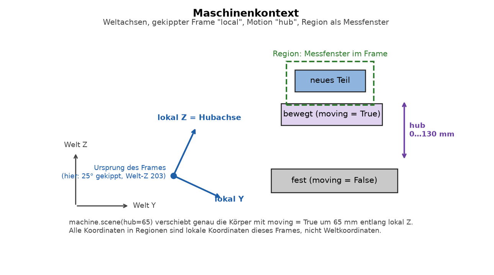
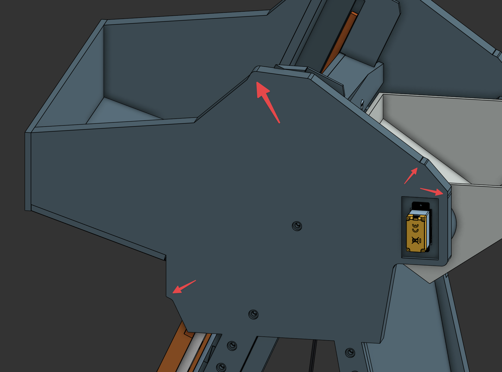

# Wie man mit dem Prüfstand denkt

Neun Begriffe. Wer sie kennt, kann jede Prüfung lesen und die meisten selbst schreiben.

## 1. Nicht das Teil prüfen, sondern das Teil in der Maschine

Ein Druckteil hat für sich genommen fast keine prüfbaren Eigenschaften. Interessant wird
es erst gegenüber dem, was darum herum steht: der Rahmen, die Hubplatte, der Riemen, das
Teil aus der Vorgängerrevision. Der Prüfstand lädt deshalb zwei Dinge:

- **das neue Teil** aus dem STEP des Projekts (`load_step(...)`, exakte Geometrie),
- **die Maschine** aus `machine.json` (`Machine.load(...)`, ein Körper je Bauteil).

```python
from pruefstand import load_step

t05 = load_step(project.root / 'native/hopper-floor-r1-native.step').one(key='T05')
rahmen = machine.body('T41L')
```

`machine.json` (Schema `pruefstand.machine/1`) entsteht einmal je Maschinenrevision aus dem
STEP-Export der Baugruppe. Es enthält je Körper: Schlüssel, Name, Rolle, Datei, SHA-256 und
das Kennzeichen `moving`. Die Tests lesen nur diese Datei und die Netze daneben; Onshape
wird nie aufgerufen.



## 2. Frame: das Koordinatensystem, in dem man denkt

Die Baugruppe steht schief. Die Riemenklemme der R6d sitzt in einer um 25° gekippten Ebene,
der Ursprung liegt 203 mm über dem Weltnullpunkt. In Weltkoordinaten ist dort keine Zahl
mehr merkbar.

Ein `Frame` ist genau diese starre Lage: `world = R @ local + t`. Die Maschine bringt ihre
Frames mit, `machine.frame('local')` holt den gekippten.

```python
loc = machine.frame('local')
v = t05.vertices(loc)          # Eckpunkte des Teils in lokalen Koordinaten
```

Damit werden Sätze wieder lesbar: „die Vorderkante liegt bei lokal Y −5,8", „das Riemenband
liegt zwischen Y 20,94 und 22,30". Diese Zahlen stehen so in den echten Tests.

`Frame.to_world` / `to_local` rechnen Punktmengen um, `direction_to_world` dreht einen
Richtungsvektor, ohne ihn zu verschieben.

## 3. Motion und Pose: dieselbe Prüfung über den ganzen Weg

`machine.json` beschreibt die Bewegungen der Maschine. Bei der R6d gibt es genau eine:
`hub`, eine Translation entlang lokal Z, Bereich 0 bis 130 mm, Standardwert 0.

```python
machine.state(hub=65)          # eine Pose
machine.scene(hub=65)          # alle Körper in dieser Pose
```

Eine `Scene` verschiebt beim Bauen genau die Körper mit `moving=True` um die Motion;
feste Körper bleiben stehen. Auswählen geht mit `.only('R10', 'R39')`, `.without('T05')`,
`.fixed` und `.moving`.

Jedes Primitiv nimmt zusätzlich `at=`. Damit wird ein Körper, der selbst `moving=True` ist,
in dieselbe Pose mitgenommen:

```python
r = overlap(p03, machine.body('R30'), at=machine.state(hub=hub))
```

Der praktische Nutzen: eine Prüfung wird über die Posen parametrisiert statt einmal in der
bequemsten Stellung gemacht.

```python
@pytest.mark.parametrize('hub', [0, 65, 130])
def test_spalt_zur_hubplatte(t05, machine, hub):
    r = gap(t05, machine.scene(hub=hub).only('R10', 'R39', 'R77'))
    assert 0.95 <= r.min_mm <= 1.1, r
```

## 4. Region: das Messfenster

Eine `Region` ist kein Körper, sondern der Ausschnitt, in dem gemessen werden soll. Sie
liegt immer in einem Frame, ihre Koordinaten sind lokale Koordinaten.

| Konstruktor | Was daraus wird |
|---|---|
| `Region.box(frame, lo, hi)` | achsparalleler Quader im Frame; `solid()`, `contains()`, `crop()` |
| `Region.cylinder(frame, origin, axis, radius, length, inner_radius=0)` | runder Ausschnitt um eine Achse; mit `inner_radius` ein Ring |
| `Region.points(frame, pts)` | eine Liste Abtastpunkte |
| `Region.plane_grid(frame, plane='xy', u=…, v=…, w=…)` | Punktraster in einer Ebene |

Ein Quader wird auf zwei Arten benutzt. Als `within=` schneidet er die Netze beider Seiten
zu, bevor gemessen wird — dann misst `gap` nur noch in diesem Fenster. Als `ignore=` nimmt
er eine Zone aus der Messung heraus. Punktregionen liefern Abtastpunkte für `coverage`.

Warum das nötig ist, zeigt der Hopperboden: der Boden **liegt auf** der Rahmenauflage auf,
Abstand 0,0 mm. Misst man die seitliche Luft zur Rahmenwand ohne Fenster, findet `gap`
immer diese Auflage und meldet 0 statt der gesuchten 0,5 mm. Der echte Test schneidet
deshalb bandweise ein Fenster sauber unter die Auflageebene:

```python
def flanke(machine, y0, y1, unter=1.0, tief=6.0):
    z = Q * (y1 + 6.1) - unter
    return Region.box(machine.frame('local'), (-130, y0, z - tief), (130, y1, z))
```

`Region.crop` schneidet Netze an den sechs Halbräumen ab und **teilt** Dreiecke, die die
Wand kreuzen, statt sie wegzuwerfen. Maschinen-STLs haben Dreiecke bis 25 mm Kantenlänge;
würden die ganz herausfallen, wäre das Fenster leer und die Messung stillschweigend falsch.

## 5. Fenster, die sich selbst messen

Ein Messfenster ist eine Behauptung darüber, wo Platz ist. Liegt seine Wand im Material,
misst es am Rand nicht mehr das Teil, sondern sich selbst — und das Ergebnis sieht
plausibel aus.

Der Fall, an dem das aufgefallen ist: der Lagerzapfen T60 der Schale R1. Ø7,9, also
r 3,95, dahinter ein Bund Ø10,5. Ein Zylinderfenster r 4,5 über den Zapfen liefert
korrekt 3,95. Dasselbe Fenster 12 statt 6 mm lang, also bis über den Bund, liefert
**4,41**. Das ist kein Zapfenmaß; das ist der Fensterradius, abzüglich einer
Dreieckskante der Tessellation. Zwei weitere Fälle derselben Art: eine Box über der
Rahmenauflage (misst die Auflage statt der seitlichen Luft) und eine Box über
Stirnwandmaterial der Altschale, die 3,94 mm „Abweichung" meldete, wo die Schnittstelle
deckungsgleich ist.

Deshalb sagt `Region.crop` seit Etappe 3, ob es beim Zuschneiden Material angeschnitten
hat, und jedes Primitiv reicht das durch:

```python
z = Region.cylinder(Frame.identity(), (-104.3, 135, 236), (1, 0, 0), radius=4.5, length=12.0)
teil = z.crop(t60.mesh)
z.meta['rand_schneidet_material']       # True -- die Mantelwand steht im Bund
r = gap(a, b, within=z)
r.fenster_schneidet_material            # True, im JSON und im Terminal als `~`
```

Das ist **kein Urteil**. Ein Fenster darf Material anschneiden; jede `within=`-Messung
eines großen Maschinenkörpers tut das. Es ist ein Hinweis darauf, dass ein Messwert am
Fensterrand erklärungsbedürftig ist. `None` heißt: es wurde gar nichts zugeschnitten
(etwa im exakten Weg von `overlap`), und dann gibt es dazu auch keine Aussage.

Beim Zylinderfenster zählt nur die **Mantel**wand. Die beiden Deckel schneiden fast
immer durch Material — man setzt ein Zylinderfenster ja über ein Rundteil, um dessen
Radius zu messen. Der Deckelbefund steht als `rand_deckel_schneidet_material` daneben.

## 6. Schnittstelle: benennen statt platzieren

Die bessere Antwort auf den Bund-Fall ist, gar kein Fenster von Hand zu setzen. Eine
`Interface` beschreibt, **was** die Stelle ist, und sucht die tragende Fläche im BRep:

```yaml
schema: pruefstand.schnittstellen/1
schnittstellen:
  - id: journal_pin
    kind: pin              # pin | bore | seat | plane
    body: T60
    axis: [1, 0, 0]
    origin: [-104.3, 135, 236]
    radius: 3.95
    length: 7.4
    partner: H608
    tolerance: {radius: 0.05, axis_deg: 0.1, offset: 0.05, gap: 0.02}
```

```python
r = interface_ok(schnittstellen['journal_pin'], teile, machine=machine)
# interface(journal_pin, pin, UNIQUE, radius_mm=3.95, axis_deg=0.0, gap_mm=0.0)[brep]
```

Gesucht werden Zylinderflächen nach Radius, Achsrichtung und Achslage (Ebenen nach
Normale und Abstand). Der Unterschied zum Fenster: der Bund Ø10,5 ist hier kein
Messwert, sondern **kein Kandidat**. Und wenn die Beschreibung nicht eindeutig passt,
entscheidet das Werkzeug nicht:

| status | heißt | Lauf |
|---|---|---|
| `UNIQUE` | genau `count` Flächen erfüllen alle Kriterien | Urteil aus Radius, Winkel, Versatz, Partnerspalt |
| `AMBIGUOUS` | mehr als `count` — die Beschreibung trennt die Geometrie nicht | `U`, unentschieden |
| `MISSING` | weniger — die beschriebene Fläche gibt es so nicht | `U`, unentschieden |

An der echten T60 sind das drei Messungen mit drei verschiedenen Ausgängen: `radius:
3.95` findet genau eine Fläche (UNIQUE, besteht), `radius: 4.5` findet keine (MISSING),
und `radius: 4.5` mit `tolerance.radius: 2` findet drei — Zentrierzapfen Ø6, Zapfen Ø7,9
und Bund Ø10,5 (AMBIGUOUS). Den nächstliegenden davon zu nehmen wäre eine Entscheidung
des Werkzeugs über die Konstruktion; die steht ihm nicht zu.

Die Suche greift dabei weiter als das Urteil (mindestens 0,25 mm im Radius, 1° im
Winkel). Sonst könnte eine gefundene Fläche nie durchfallen — sie wäre ja mit genau der
Urteilstoleranz gefunden worden. So fällt eine knapp verfehlte Fläche als **Fehler** auf
(`verletzt: ["radius 1.2 statt 1.31 (0.110 > 0.05)"]`) und verschwindet nicht als
MISSING.

Steht `partner` in der Pflegedatei, wird zusätzlich der Abstand zum Maschinenkörper im
Schnittstellenfenster gemessen: Formschluss heißt 0,0 ± 0,02 mm. Am Hornsitz der Schale
sind das 0,0159 mm. Dieser Nebenwert ist ein Mesh-Urteil und steht als eigener
`gap`-Eintrag im Bericht — `urteil_auf` der Schnittstelle selbst bleibt `brep`.

## 7. Form: die Stilregeln messen



Marc am 17.09.2026, mit Pfeilen im Bild: Konturversätze von 1 bis 3 mm in der
Seitenplatte, entstanden, weil Blöcke aneinandergesetzt wurden, statt die Kontur
durchzuziehen. „Unnötige Shapes statt eines homogenen Bodies." Die Regel dazu steht
längst in den Designregeln (keine Kerben, saubere Übergänge, R4,2 an Außenkanten,
0,42 mm Bahnbreite) — nur hat sie bisher niemand nachgemessen.

Messbar ist sie rein im BRep, ganz ohne Messfenster. Grundlage ist `kanten(body)`:
jede Kante mit Länge, Kurventyp, Knickwinkel und — der eigentliche Punkt — **konvex
oder konkav**. Konvex ist eine Außenecke (das Material liegt im spitzen Keil), konkav
eine Innenecke. An der Wanne T01 sind das 79 Kanten: 54 konvex, 11 konkav, 14
tangential (Übergänge auf Rundungen, dort gibt es keine Ecke).

| Regel | sucht | Wanne T01 | Hopperboden T05 |
|---|---|---|---|
| `absatz` | konvex + konkav, parallel, 0,3–3 mm auseinander, schmale Stufe dazwischen | 0 | **6** (0,32–0,35 mm) |
| `kerbe` | konkave Kante mit eigener Gegenwand in 0,2–2,5 mm, ohne Anker | 0 | 2 Zonen, beide erklärt |
| `unverrundet` | konvexe Außenkante, 80–100°, > 5 mm, ohne Rundung | **16** (1694 mm) | **32** (1159 mm) |
| `splitter` | Kanten < 0,42 mm, Flächen < 1 mm², unverschmolzene Nachbarn | 0/0/0 | **34/16/0** |

Die Zahlen sind aus dem Lauf vom 18.09.2026, nicht geschätzt. Sie zeigen den
Unterschied, um den es geht: die Wanne ist aus einer durchgezogenen Kontur gebaut, der
Hopperboden aus Blöcken — und man sieht es in vier unabhängigen Maßen.

**Kerben brauchen einen Anker.** Ein 0,3-mm-Spalt zwischen zwei eigenen Wänden ist so
lange kein Fehler, wie dort etwas hineingehört. `kerbe` bündelt enge Stellen im 5-mm-Raster
zu Zonen und fragt je Zone: steht im Ankerradius ein Kontextkörper (über **alle** Posen) oder
eine Schraube aus `schrauben.yaml`, oder steht die Zone in `spec/form.yaml` unter
`erklaert:`? Am Hopperboden sind die beiden Zonen (0,2812 mm Spalt über je 6,51 mm bei
|X| 112,16) durch T41L/R in 0,478 mm erklärt — Fuge zum Rahmen, kein Befund.

Der Ankerradius ist **nicht fest**, sondern `max(2,5 mm, 3 · Spaltbreite)`. Der Grund steht
in den R6d-Rahmenplatten: dort sind 13 Sitze 1,45 mm breit, und das Teil, das sie aufnehmen,
beginnt erst 3,7 bis 4,0 mm weiter. Mit festen 2,5 mm meldete der Prüfstand jede dieser Fugen
als Kerbe; mit dem Faktor sind sie erklärt — und die echten Nuten bleiben stehen, weil deren
nächster Partner erst bei 5,5 mm und weiter beginnt. Zwischen 4,0 und 5,5 mm liegt nichts,
die Trennung ist also nicht knapp. Der angewandte Radius steht an jeder Zone, und beide Werte
lassen sich je Teil in `form.yaml` setzen.

**Drei Sorten Absatz.** Eine Seitenplatte meldet 38 Befunde, und Marcs Pfeile zeigen auf
vier. `sorte` trennt sie nach den Normalen der drei Flächen, bezogen auf die Plattenachse:
`umriss` (die Silhouette springt), `banddicke` (die Stirnfläche des Randbandes wird stufig
schmaler) und `pad` (ein aufgesetzter Block mitten auf der großen Fläche). An T41L sind das
1 / 13 / 24, an T41R 1 / 10 / 31 — die zwei sichtbaren Sorten machen 14 bzw. 11 aus, und
genau auf die zeigen die Pfeile.

**Was keine Außenkante ist.** Zwei Dinge fallen bei `unverrundet` bewusst heraus: Kanten,
die in eine Tasche schauen (der Strahl entlang der Winkelhalbierenden trifft den eigenen
Körper), und Bohrungsmündungen — ein Kreis, dessen Krümmungsmittelpunkt nicht im Material
liegt, ist der Rand eines Lochs und keine Ecke des Teils. Ohne diese zweite
Unterscheidung stünden an der Wanne 23 statt 16 Kandidaten im Bericht, und in ein
Ø3,4-Loch passt kein R4,2.

**Ein tangentialer Fillet ist kein Splitter.** `splitter` suchte anfangs alle Nachbarflächen
mit Knick unter 0,5°, die trotzdem eine Kante trennt. Eine saubere Verrundung ist aber genau
das: Ebene, Kante, Zylinder, Knick 0. Über die 15 R6d-Teile waren *alle* 145 Treffer dieser
Art. Gemeldet wird deshalb nur noch, was zwischen zwei **ungekrümmten** Flächen glatt
durchläuft; die Übergänge auf Rundungen zählt das Ergebnis weiter mit, nur eben unter ihrem
richtigen Namen.

**Was der Prüfstand nicht weiß, sagt er als Obergrenze.** Bettkanten werden nie verrundet,
Fugenkanten fasst niemand an. Solange niemand sagt, wie das Teil im Drucker liegt und was
daneben sitzt, zählen beide mit — die 2,3 bis 5,4 m scharfe Kante je Rahmenplatte sind so
entstanden. `unverrundet` markiert das selbst, und im Terminal steht dann `anzahl=≤104`
statt `anzahl=104`. Mit `spec/teile.yaml` (Druckpose, Auflagefläche, `griffkanten: ja/nein`)
und dem Maschinenkontext fallen beide Gruppen heraus, und aus der Obergrenze wird ein
Messwert. `griffkanten: nein` heißt zugleich: hier gilt nicht R4,2, sondern der Kantenbruch
R1,0 — die Hausregel meint frei anfassbare Außenkanten, keine Rahmenplatte.

Alles davon ist **Warnung**, nie Fehler. Ob eine scharfe Kante Absicht ist, entscheidet
Marc; der Prüfstand sagt nur, wo sie ist und wie lang.

## 8. Fehler oder Warnung

Zwei Klassen, festgelegt in `HANDOFF.md`:

- **Fehler** blockieren das Slicen: Geometrie, Schrauben, Werkzeugzugang, Montage-Sweeps.
  Ein normaler `assert`.
- **Warnung** ist sichtbar, aber nicht blockierend: Druckpose, Stabilitätsindex, Stil.
  Dafür gibt es den Marker.

```python
@pytest.mark.warnung
def test_druckpose(...):
    ...
```

Ein fehlschlagender Test mit diesem Marker erscheint im Terminal als `W` / `WARNUNG` und
lässt den Exit-Code auf 0.

Der dritte Fall ist der bekannte Fehler, der rot bleiben **soll**:

```python
VARIANTEN = ['R1', pytest.param('R6d', marks=pytest.mark.xfail(
    strict=True, reason='R6d: Lücke neben den Wagen'))]
```

`strict=True` heißt: wird der Fall eines Tages grün, scheitert der Lauf. Entweder ist dann
die Messung kaputt oder jemand hat die Referenzgeometrie verändert. Beides will man wissen.

## 9. „Nichts gemessen" ist nicht „bestanden"

Der gefährlichste Zustand ist eine Prüfung, die durchläuft, weil sie ins Leere gegriffen
hat: Region daneben gelegt, Körperschlüssel vertippt, Ausschnitt zu klein. Ein `assert
r.min_mm > 0.5` ist dann grün, ohne dass irgendetwas gemessen wurde.

Deshalb merkt sich jedes Primitiv, wenn es keine Geometrie zu messen hatte
(`results.mark_empty`), und das pytest-Plugin dreht einen bestandenen Test wieder auf
fehlgeschlagen:

```
nichts gemessen: Region enthält keine Geometrie
gap: nichts gemessen: Region enthält keine Geometrie (min_mm=inf, kein Körperpaar im Ausschnitt)
```

Wer diese Meldung sieht, hat kein Geometrieproblem, sondern ein Messproblem: Region
korrigieren, nicht Toleranz aufweichen.

## 10. Zwei weitere Nicht-Urteile

„Nichts gemessen" hat zwei Geschwister, und alle drei sind kein Fehlschlag, sondern ein
fehlendes Urteil:

**Unentschieden** heißt: die Anforderung ließ sich keiner Geometrie zuordnen. Der Vorgänger
fehlt, der Anker wurde nicht gefunden. Das ist ausdrücklich kein Verstoß — ein nicht
gefundener Anker beweist gar nichts. Der Lauf zeigt dafür ein `U` und endet trotzdem nicht
mit Erfolg, sonst rutschen unverbundene Anforderungen still durch.

**Technischer Fehler** heißt: das Messverfahren selbst ist gescheitert. Der häufigste Fall ist
ein Boolean, den OCCT verweigert. Der Prüfstand rechnet ihn nie in eine Zahl um:

```
technischer Fehler: das Messverfahren ist gescheitert, der Messwert ist keiner
overlap: … (T05 gegen T09: Schnitt gescheitert: BOPAlgo …)
```

Der Unterschied ist wichtig, weil „Volumen 0,0 mm³" sich liest wie „keine Überschneidung" —
und genau das hat in diesem Fall niemand gemessen. Wer einen ganz harten Absturz absichern
will (Signal statt Ausnahme), setzt `PRUEFSTAND_KERNWAECHTER=1`; dann rechnet ein eigener
Prozess, und sein Tod wird zum technischen Fehler statt zum Ende des Laufs.

Dazu kommt `urteil_auf`: es steht an jedem Messwert und sagt, ob `passed` auf dem BRep oder
auf einer Abtastung beruht. Ein exakt gerechneter Nebenwert macht ein abgetastetes Urteil
nicht exakt.

## 11. Prüfbudget: was dieser grüne Lauf angesehen hat

Ein grüner Lauf sagt „nichts verletzt". Er sagt nicht, *woran*. Deshalb trägt jeder
Testeintrag in `var/review/pruefstand.json` ein Budget:

```json
"budget": {
  "geprueft":      [{"primitiv": "gap", "koerper_n": 2, "koerper": ["T60", "H608"],
                     "urteil_auf": "mesh", "pose": {"schwenk": -135.0}}],
  "uebersprungen": [{"was": "brep", "anzahl": 102, "keys": ["C00", "..."]}],
  "angenommen":    [{"primitiv": "kerbe", "regel": "kerbe", "spalt_mm": [0.2, 2.5],
                     "raster_mm": 5.0, "anker_mm": 2.5}],
  "koerper":       {"T60": true, "H608": false}
}
```

`geprueft` ist, was tatsächlich gemessen wurde (Primitiv, Körper, Pose);
`uebersprungen`, was dabei ausgelassen wurde (Körper ohne BRep, leere Fenster, fehlende
Zuordnung); `angenommen`, worauf das Urteil beruht (`urteil_auf`, Raster, Grenzwerte
der Regel). Am Kopf des Berichts steht die Summe des Laufs, im Terminal als eine Zeile:

```
Budget: 210 Messungen an 117 Körpern (102 davon nur Netz), 233 übersprungen, 219 Annahmen
```

Die 102 Netzkörper sind der wichtigste Posten: an ihnen rechnet niemand exakt, ihre
Maschinen-STLs sind tesselliert. Das war vorher wahr und unsichtbar.

Die Gegenrichtung dazu ist `status: not_built_yet` in den Pflegedateien
(`schrauben.yaml`, `schnittstellen.yaml`, `montage.yaml`). Eine Anforderung, deren Teil
es noch nicht gibt, wird damit ausdrücklich **unentschieden** statt stillschweigend
grün — und bleibt in der Datei stehen, statt auskommentiert zu werden und in Vergessenheit
zu geraten.

## Was am Ende herauskommt

Jedes Primitiv liefert ein Ergebnisobjekt, kein nacktes `True`. Es lässt sich direkt in
einen `assert` schreiben (`__bool__`) und als Begründung mitgeben (`repr`):

```python
assert 0.95 <= r.min_mm <= 1.1, r
#   AssertionError: gap(min_mm=0.99999, penetrating=0)
```

Parallel wandert jeder Messwert in den Bericht `<projekt>/var/review/pruefstand.json`,
und das Terminal zeigt nach dem Lauf je Test eine Zeile mit den ersten drei Kennzahlen.
Abdeckungskarten landen als `coverage-<test>.png` daneben.

Weiter: [primitive.md](primitive.md) zeigt die Messungen einzeln.
