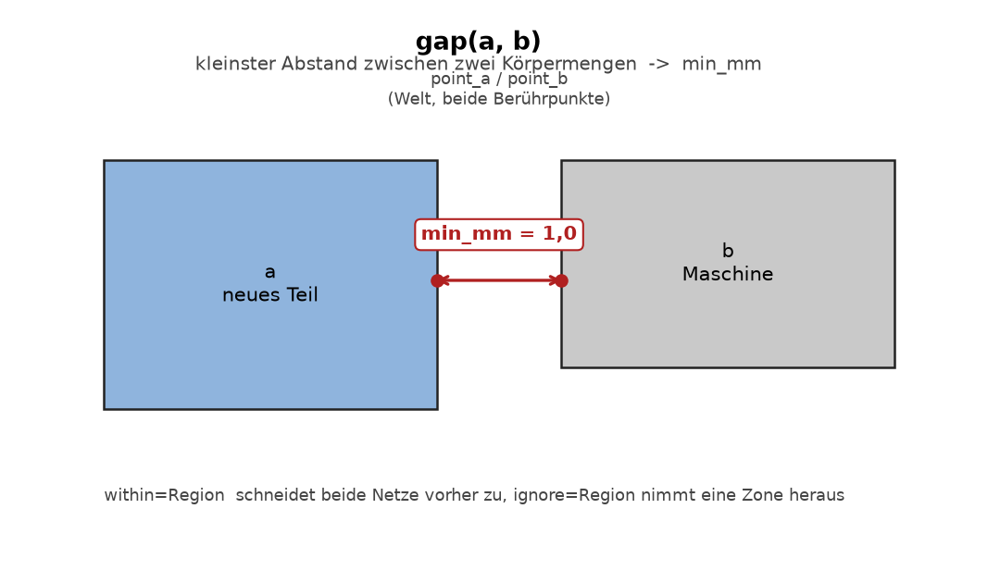
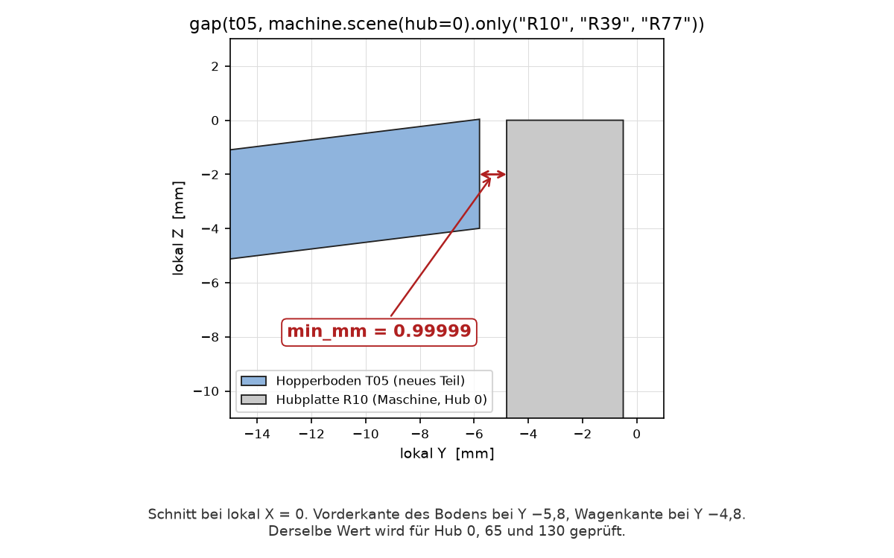
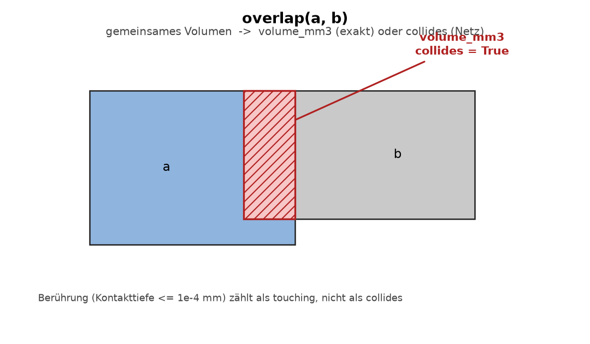
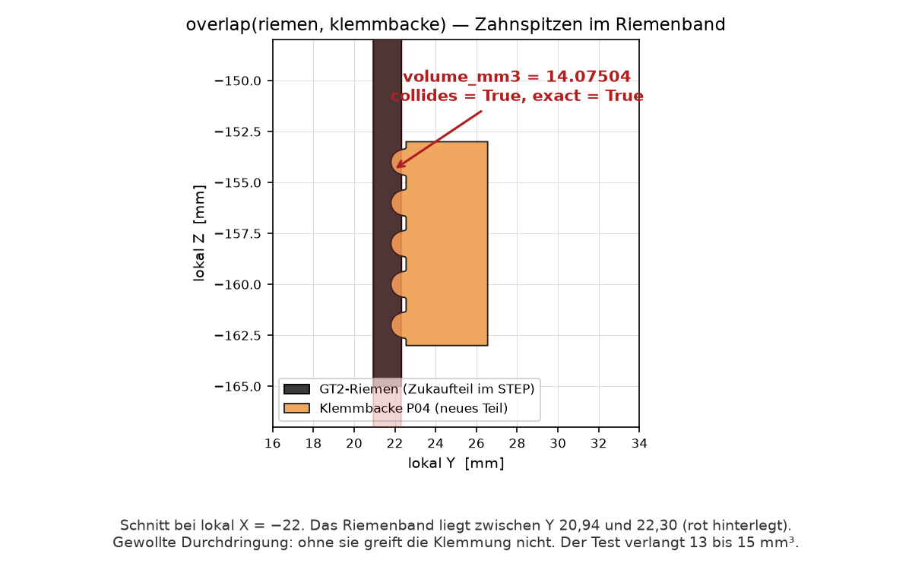
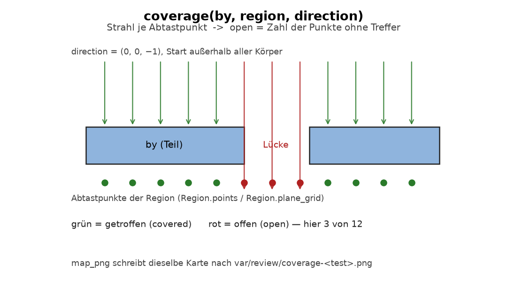
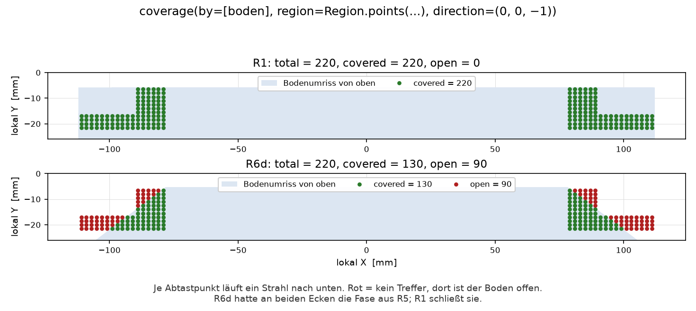
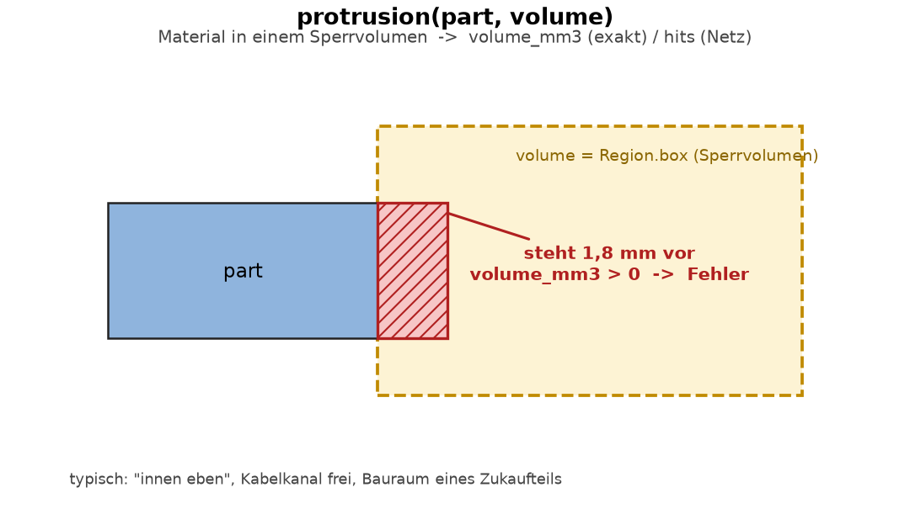
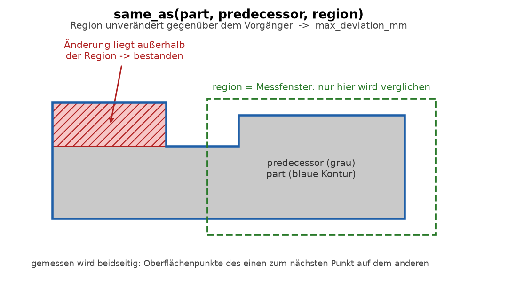
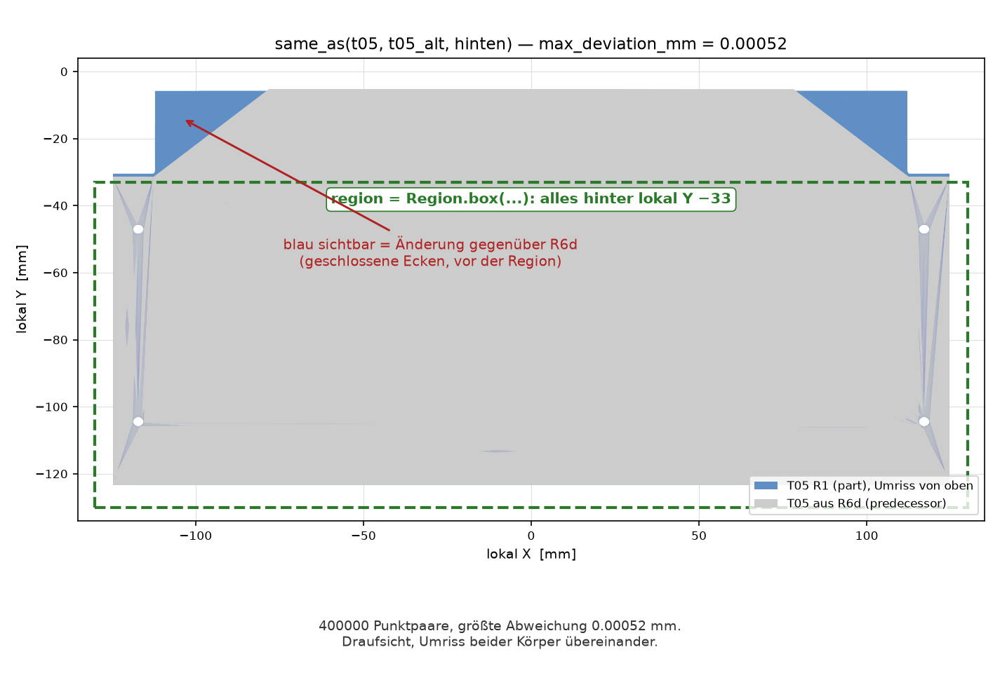

# Die beschriebenen Primitive

Jedes Primitiv beantwortet genau eine Frage und gibt eine Zahl zurück. Kein Primitiv
entscheidet, ob ein Teil gut ist — das entscheidet der `assert` daneben.

Gemeinsames:

- `a`, `b`, `by`, `part` nehmen einen `Body`, eine Liste von Bodies oder eine `Scene`.
- `at=machine.state(hub=…)` (oder eine `Scene`) verschiebt alle übergebenen Körper mit
  `moving=True` in diese Pose.
- Die Ergebnisse sind Datenklassen mit `bool()`, `repr()`, `as_dict()` und `summary()`.
  Deshalb funktioniert `assert bedingung, r` und schreibt die Messwerte in die Meldung.
- Wenn ein Primitiv nichts zu messen hatte, markiert es das; der Test wird dann rot,
  auch wenn die Bedingung formal erfüllt war (siehe [konzepte.md](konzepte.md)).
- Jedes Ergebnis trägt `urteil_auf` (`'brep'` oder `'mesh'`) und, sobald ein Fenster im
  Spiel war, `fenster_schneidet_material`. Im Terminal stehen sie als `[mesh]` hinter
  dem Messwert und als `~` vor der Zeile.

Inhalt: [gap](#gap) · [overlap](#overlap) · [coverage](#coverage) ·
[protrusion](#protrusion) · [same_as](#same_as) · [interface_ok](#interface_ok) ·
[Form: absatz, kerbe, unverrundet, splitter](#form-absatz-kerbe-unverrundet-splitter) ·
[in Arbeit](#in-arbeit)

---

## gap

**Frage:** Wie weit ist das Teil von der Maschine entfernt, an der engsten Stelle?

```python
gap(a, b, at=None, within=None, ignore=None, min_mm=None, max_mm=None) -> GapResult
```



| Rückgabe | Bedeutung |
|---|---|
| `min_mm` | kleinster Abstand über alle Körperpaare, in mm |
| `point_a`, `point_b` | die beiden nächsten Punkte, in Weltkoordinaten |
| `pair` | Schlüssel des engsten Körperpaars |
| `per_body` | kleinster Abstand je Gegenkörper (bei einem Körper in `a`: dessen Schlüssel) |
| `penetrating` | `True`, wenn ein Paar sich wirklich durchdringt — **nicht** schon bei Abstand 0 |
| `penetration_auf` | woher diese Aussage kommt: `brep` (exakter Schnitt), `mesh` (Eindringtiefe > 0,01 mm) oder `unentschieden` (offenes Netz) |
| `durchdringung_mm` | größte Eindringtiefe des Netzwegs; im BRep-Weg 0,0, dort zählt das Volumen |
| `passed` | nur gesetzt, wenn `min_mm` / `max_mm` übergeben wurden |

**Berührung ist keine Kollision.** Zwei bündig aufeinander liegende Flächen haben Abstand
0,0 mm — genau wie zwei Körper, die ineinanderstecken. Der Kollisionskern kann beides nicht
trennen (für koinzidente Netze meldet er sogar die volle Körpertiefe: zwei bündige 10er-Würfel
ergeben „10 mm Durchdringung"). `gap` rechnet deshalb nach: mit zwei Solids und ohne Messfenster
über den exakten Schnitt, sonst über die Tiefe, mit der Stützpunkte und Facettenmitten des einen
im anderen liegen. Der Formschluss T40↔T41 der R6d stand vorher als `penetrating=True` im
Bericht, während `overlap` daneben 0,0 mm³ sagte.

`within=Region.box(...)` schneidet beide Seiten vor der Messung auf das Fenster zu,
`ignore=Region.box(...)` nimmt eine Zone heraus (etwa eine gewollte Auflagefläche).
`min_mm` / `max_mm` sind optional; in den echten Tests steht die Toleranz meist als
`assert`, weil dort auch die Begründung hingehört.

**Echtes Beispiel** (Hopperboden R1, Vorderkante zur Hubplatte, über den ganzen Hub):

```python
@pytest.mark.parametrize('hub', [0, 65, 130])
def test_spalt_zur_hubplatte(t05, machine, hub):
    """Vorderkante senkrecht bei lokal Y −5,8; Wagen bei −4,8: Soll 1,0 mm über den ganzen Hub."""
    r = gap(t05, machine.scene(hub=hub).only('R10', 'R39', 'R77'))
    assert 0.95 <= r.min_mm <= 1.1, r
```

Ergebnis für alle drei Posen: `gap(min_mm=0.99999, penetrating=0)`.



---

## overlap

**Frage:** Durchdringen sich zwei Körper, und mit welchem Volumen?

```python
overlap(a, b, at=None, within=None, max_mm3=None) -> OverlapResult
```



Zwei Rechenwege, abhängig davon, was geladen wurde:

- **exakt** — alle beteiligten Körper kommen aus einem STEP und haben einen Solid.
  Dann wird boolesch geschnitten: `volume_mm3` ist echtes Volumen, `exact=True`.
- **über Netze** — ist mindestens ein Körper nur als STL geladen, entscheidet der
  Kollisionskern (python-fcl). Dann ist `volume_mm3` **None**, und es gibt stattdessen
  `collides`, `contacts` und `max_penetration_mm`.

Das ist die häufigste Stolperfalle: `r.volume_mm3 < 0.01` läuft gegen einen
Maschinenkörper aus STL auf einen `TypeError`, weil dort `None` steht. Entweder gegen
`collides` prüfen oder beide Seiten aus dem STEP nehmen.

| Rückgabe | Bedeutung |
|---|---|
| `volume_mm3` | gemeinsames Volumen in mm³, oder `None` im Netzweg |
| `collides` | echte Durchdringung |
| `touching` | Berührung ohne Durchdringung (Kontakttiefe ≤ 1e-4 mm) |
| `exact` | exakt gerechnet, nicht über Netze |
| `contacts`, `max_penetration_mm` | Kontaktzahl und Tiefe aus dem Netzweg |
| `pairs`, `touch_pairs` | die beteiligten Körperpaare |

**Echtes Beispiel 1** — gewollte Durchdringung. Ohne sie greift die Klemmung nicht:

```python
@pytest.mark.parametrize('name', VARIANTEN)
def test_backen_greifen_in_den_riemen(teile, machine, name):
    """Nominaler Zahneingriff der Backen in das ungezahnte Riemenband: rund 14 mm³ je Backe."""
    for jaw in jaws:
        r = overlap(belt, jaw)
        assert r.collides, r
        assert 13.0 <= r.volume_mm3 <= 15.0, r
```

R1: `overlap(volume_mm3=14.07504, collides=1, exact=1)`.
R6d: `overlap(collides=0, exact=0, contacts=0)` — der Fall aus [warum.md](warum.md).



**Echtes Beispiel 2** — verbotene Durchdringung, mit Fenster. Der Schraubenschaft darf im
Piloten sitzen, aber nirgends sonst:

```python
def test_schrauben_nur_im_pilot(teile, machine):
    """Außerhalb der Piloten (lokal Y > 21,1) darf kein Schraubenmaterial in P03 stehen."""
    aussen = Region.box(machine.frame('local'), (-200, 21.1, -400), (200, 81.1, 400))
    for s in teile['screws']:
        r = overlap(s, teile['p03'], within=aussen)
        assert r.volume_mm3 < 0.01, r
```

---

## coverage

**Frage:** Ist eine Fläche dicht, oder fällt dort etwas durch?

```python
coverage(by, region, direction, at=None, max_open=None) -> CoverageResult
```



Je Abtastpunkt der Region läuft ein Strahl in `direction`. Der Start liegt so weit
zurückversetzt, dass er außerhalb aller beteiligten Körper beginnt (Diagonale der
Gesamt-Bounding-Box plus 50 mm). Trifft der Strahl einen der Körper in `by`, gilt der
Punkt als abgedeckt.

| Rückgabe | Bedeutung |
|---|---|
| `total`, `covered`, `open` | Abtastpunkte gesamt, getroffen, offen |
| `fraction` | `covered / total` |
| `open_points` | die offenen Punkte in Weltkoordinaten — damit findet man die Stelle |
| `map_png` | Pfad der Karte, die nebenbei nach `var/review/coverage-<test>.png` geschrieben wird |

**Echtes Beispiel** (Hopperboden, beide Vorderecken):

```python
@pytest.mark.parametrize('name', VARIANTEN)
def test_ecken_geschlossen(t05, t05_alt, machine, name):
    part = variante(t05, t05_alt, name)
    region = Region.points(machine.frame('local'), eckpunkte())
    r = coverage(by=[part], region=region, direction=(0, 0, -1))
    assert r.total == 220
    assert r.open == 0, r
```

R1: `coverage(total=220, covered=220, open=0)`.
R6d: `coverage(total=220, covered=130, open=90)`.



Der `assert r.total == 220` ist kein Schmuck. Er hält die Zahl der Abtastpunkte fest;
verrutscht die Region, ändert sich `total` und der Test fällt auf, anstatt mit weniger
Punkten weiter grün zu sein.

---

## protrusion

**Frage:** Steht Material in ein Volumen vor, das frei bleiben muss?

```python
protrusion(part, volume, at=None, max_mm3=0.0) -> ProtrusionResult
```



`volume` ist eine `Region.box`. Hat das Teil einen Solid (STEP), wird boolesch geschnitten:
`volume_mm3` ist das vorstehende Volumen, `exact=True`, bestanden bei `volume_mm3 <=
max_mm3`. Liegt nur ein Netz vor, werden stattdessen die Eckpunkte im Quader gezählt
(`hits`), und bestanden heißt `hits == 0` — das ist gröber, weil eine Wand mitten durch
den Quader laufen kann, ohne dass ein Eckpunkt darin liegt.

| Rückgabe | Bedeutung |
|---|---|
| `volume_mm3` | vorstehendes Volumen in mm³, oder `None` ohne Solid |
| `hits` | Eckpunkte des Teils innerhalb des Volumens |
| `exact` | exakt gerechnet |

Typische Anwendung laut `HANDOFF.md`: „Schale innen eben", ein freizuhaltender Kabelkanal,
der Bauraum eines Zukaufteils.

**Kein echtes Beispiel vorhanden.** Von den beiden Referenzprojekten ruft keines
`protrusion` auf — der Hopperboden und die Riemenklemme brauchen es nicht. Sobald ein
Projekt es benutzt, gehört das Beispiel hierher; bis dahin steht hier absichtlich keine
erfundene Zahl.

---

## same_as

**Frage:** Ist ein Bereich gegenüber der Vorgängerrevision wirklich unverändert?

```python
same_as(part, predecessor, region, at=None, max_deviation_mm=None, erwartet=()) -> SameAsResult
```



Beide Körper werden auf `region` beschnitten, dann werden auf jeder Oberfläche Punkte
abgetastet (etwa 5 Punkte je mm², höchstens 200 000 je Seite) und zum jeweils nächsten
Punkt der Gegenseite gemessen — in beide Richtungen, weil eine Richtung allein hinzugefügtes
Material übersieht. Haben beide Körper einen Solid, kommt zusätzlich das exakte
Differenzvolumen dazu.

| Rückgabe | Bedeutung |
|---|---|
| `max_deviation_mm` | größte Abweichung, beidseitig gemessen |
| `diff_mm3` | exaktes Differenzvolumen in mm³ (beide Richtungen addiert), sonst `None` |
| `samples` | Zahl der verglichenen Punkte (beide Seiten zusammen) |
| `exact` | Differenzvolumen exakt gerechnet |
| `erwartet_ausgenommen` | Abtastpunkte, die in einer `erwartet`-Region lagen und nicht zählten |

`erwartet=[Region, …]` benennt Unterschiede, die keine Abweichung sind. Nicht jede
Änderung verlässt die Schnittstelle: der Lagerzapfen T60 hat gegenüber der alten Wanne
T01 eine Pilotbohrung für die M3 von innen bekommen. Im Ring r 12,6 um den Pivot misst
der Vergleich deshalb **3,65 mm** — und sieht aus wie ein Konstruktionsfehler. Nimmt man
die Bohrung als Zylinder r 1,5 auf der Achse heraus, bleiben **0,0012 mm**
Abtastrauschen:

```python
r = same_as(t60, alt, ring, erwartet=[pilot])
# same_as(max_deviation_mm=0.0012, samples=1820, erwartet_ausgenommen=180)[mesh]
```

Der Test schreibt beide Zahlen hin. Ein Ausnehmen, das nur die kleine Zahl zeigt, ist
von einem Weichrechnen nicht zu unterscheiden. `diff_mm3` zählt den erwarteten
Unterschied übrigens weiter mit — nur das Urteil nimmt ihn heraus.

**Echtes Beispiel** (Hopperboden: geändert wurde nur vorne, hinten muss alles gleich sein):

```python
def test_rueckseite_geometrisch_unveraendert(t05, t05_alt, machine):
    """Alles hinter lokal Y −33 ist gegenüber R6d unverändert."""
    hinten = Region.box(machine.frame('local'), (-130, -130, -30), (130, -33, 30))
    r = same_as(t05, t05_alt, hinten)
    assert r.max_deviation_mm < 0.05, r
```

Ergebnis: `same_as(max_deviation_mm=0.00052, samples=400000, exact=0)`. Die 0,0005 mm sind
Abtastrauschen, keine Geometrieänderung.



Im Bild liegen beide Umrisse übereinander, der Vorgänger grau darüber. Was blau
durchscheint, ist die Änderung — und sie liegt vor der Region, also außerhalb dessen, was
dieser Test zusichert.

---

## interface_ok

**Frage:** Ist die Stelle, an der das Teil die Maschine greift, wirklich die Fläche, die
sie sein soll?

```python
interface_ok(iface, parts, at=None, machine=None, partner_body=None) -> InterfaceResult
```

Anders als die fünf oben nimmt dieses Primitiv kein von Hand gesetztes Fenster, sondern
eine benannte Schnittstelle aus `spec/schnittstellen.yaml` und sucht die tragende Fläche
im BRep — Zylinder nach Radius, Achsrichtung und Achslage, Ebenen nach Normale und
Abstand. Warum das der bessere Weg ist, steht in
[konzepte.md](konzepte.md#6-schnittstelle-benennen-statt-platzieren).

| Rückgabe | Bedeutung |
|---|---|
| `status` | `UNIQUE` / `AMBIGUOUS` / `MISSING` — die letzten beiden sind unentschieden, nie grün |
| `radius_mm`, `axis_deg`, `offset_mm` | gemessen an der gefundenen Fläche, exakt aus dem BRep |
| `gap_mm` | Abstand zum `partner` im Schnittstellenfenster; Formschluss = 0,0 ± 0,02 |
| `candidates` | **alle** passenden Flächen mit Fläche, Radius, Winkel, Versatz |
| `verletzt` | welches Kriterium reißt, im Klartext mit Messwert |

**Echtes Beispiel** (Schale R1, Lagerzapfen im 608):

```python
def test_lagerzapfen_ist_die_flaeche_die_er_sein_soll(teile, machine, schnittstellen):
    r = interface_ok(schnittstellen['journal_pin'], teile, machine=machine)
    assert r.status == UNIQUE, r.candidates
    assert r.radius_mm == pytest.approx(3.95, abs=0.001)
    assert r.gap_mm == pytest.approx(0.0, abs=0.02)
```

Ergebnis: `interface(journal_pin, pin, UNIQUE, radius_soll_mm=3.95, radius_mm=3.95,
axis_deg=0.0, offset_mm=0.0, gap_mm=0.0)[brep]`. Der Gegenfall `radius: 4.5` an derselben
Achse liefert `MISSING` mit leerer Kandidatenliste — ein Messfenster hätte an dieser
Stelle 4,41 gemeldet und plausibel ausgesehen.

---

## Form: absatz, kerbe, unverrundet, splitter

**Frage:** Ist das Teil aus einer durchgezogenen Kontur gebaut — oder aus Blöcken?

```python
kanten(body) -> list[Kante]
absatz(body, *, versatz_mm=(0.3, 3.0), parallel_deg=2.0, achse=None) -> AbsatzResult
kerbe(body, kontext=None, at=None, *, schrauben=(), erklaert=None, machine=None,
      spalt_mm=(0.2, 2.5), knick_deg=60.0, raster_mm=5.0,
      anker_mm=None, anker_faktor=None) -> KerbeResult
unverrundet(body, pose=None, *, teil=None, kontext=None, at=None, machine=None,
            knick_deg=(80.0, 100.0), min_mm=5.0, radius_mm=None,
            fuge_mm=1.0) -> UnverrundetResult
splitter(body, *, kante_mm=0.42, flaeche_mm2=1.0, nachbar_mm2=100.0,
         knick_deg=0.5) -> SplitterResult
```

Alle vier arbeiten **nur auf dem BRep** und urteilen auf `brep`. Ein Körper ohne Solid
(Maschinen-STL) wird `unentschieden` mit dem Grund „kein BRep" — ein Dreiecksnetz knickt
an jeder Facette, Kanten sind daran nicht messbar. Alle vier sind **Warnungen**
(`@pytest.mark.warnung`); ob eine scharfe Kante Absicht ist, entscheidet Marc.

`kanten(body)` ist die Grundlage: je Kante `laenge_mm`, `typ` (Line / Circle / …),
`knick_deg`, `mitte` (Welt), `richtung`, `normalen`, `flaechen` (Indizes wie bei
`interface_ok`: `<key>#i`) und `art` — `konvex`, `konkav`, `tangential` (Knick < 1°,
Übergang auf eine Rundung) oder `unentschieden`.

| Rückgabe | Bedeutung |
|---|---|
| `absatz.absaetze` | je Absatz `ort`, `versatz_mm`, `laenge_mm`, **`sorte`**, `flaechen` (Wand/Stufe/Wand), `stufe_mm2` |
| `absatz.sorten` / `.achse` | Zählung je Sorte und die Plattenachse, nach der sortiert wurde |
| `kerbe.zonen` | je Zone `ort`, `spalt_mm`, `laenge_mm`, `partner`, `partner_mm`, **`anker_mm`**, `erklaert`, `grund` |
| `unverrundet.kanten` | je Kante `ort`, `laenge_mm`, `typ`, `knick_deg`, `nach_aussen` |
| `unverrundet.ausnahmen` / `.obergrenze` | was ausgenommen wurde — und ob die Zahl deshalb nur eine Obergrenze ist |
| `splitter.kurze_kanten` / `.winzige_flaechen` / `.unverschmolzen` | drei Listen, `anzahl` ist ihre Summe |
| `splitter.rundungsuebergaenge` | tangentiale Übergänge auf eine Rundung — gezählt, aber **kein** Befund |

**Die drei Sorten eines Absatzes.** Eine Seitenplatte meldet 38 Absätze, und Marcs Pfeile
zeigen auf vier davon. `sorte` trennt sie nach den Normalen der drei beteiligten Flächen,
bezogen auf die Plattenachse (die dünnste Hüllrichtung, per `achse=` überschreibbar):

| Sorte | was man sieht | T41L | T41R |
|---|---|---|---|
| `umriss` | die Silhouette springt | 1 | 1 |
| `banddicke` | die Stirnfläche des Randbandes wird stufig schmaler | 13 | 10 |
| `pad` | ein aufgesetzter Block mitten auf der großen Fläche | 24 | 31 |

Die zwei ersten Sorten sind das, worauf die Pfeile zeigen — 14 bzw. 11 Befunde statt 38 bzw. 42.

**Die R4,2-Zahl ohne `teile.yaml` ist eine Obergrenze.** Bettkanten werden nie verrundet,
Fugenkanten fasst niemand an — beide zählen mit, solange niemand sagt, wie das Teil liegt und
was daneben sitzt. `unverrundet` markiert das selbst (`obergrenze`), und der Terminalbericht
schreibt `anzahl=≤104`. Mit `teil=` aus `spec/teile.yaml` (Druckpose, Auflage,
`griffkanten: ja/nein`) und `kontext=` fallen beide Gruppen heraus, und erst dann ist die Zahl
ein Messwert. `griffkanten: nein` setzt zugleich die Schwelle von R4,2 auf den Kantenbruch
R1,0 — die Hausregel gilt für frei anfassbare Außenkanten, nicht für eine Rahmenplatte.

**Echtes Beispiel** (Hopperboden T05, wo alle vier etwas finden):

```python
@pytest.mark.warnung
def test_der_boden_hat_keine_absaetze(t05):
    r = absatz(t05)
    assert r.anzahl == 0, r.absaetze
```

Ergebnis: `absatz(anzahl=6, max_versatz_mm=0.354)[brep]` — zwei lange Versätze von
0,3332 mm über 26,66 mm bei |X| 101,4 und vier kurze an den Wagenecken. Dieselbe Prüfung
an der Wanne T01 liefert 0.

`kerbe` bündelt enge Stellen im 5-mm-Raster und fragt je Zone nach einem Anker:

```python
r = kerbe(t05, machine.scene())
# kerbe(anzahl=2, unerklaert=0, enge_kanten_mm=13.02, min_spalt_mm=0.2812)[brep]
```

Beide Zonen tragen `partner: T41L` bzw. `T41R` in 0,478 mm — die Fuge zum Rahmen. Ohne
Kontextkörper bliebe dieselbe Stelle unerklärt; das steht dann als `uebersprungen`
im Prüfbudget.

**Der Ankerradius wächst mit der Spaltbreite** (`max(anker_mm, anker_faktor · spalt)`,
Vorgabe 2,5 mm und 3,0). Ein fester Radius ist falsch: ein 1,45 mm breiter Sitz nimmt ein Teil
auf, das erst 3,7 mm weiter beginnt. An den R6d-Rahmenplatten waren 13 solcher Sitze als
unerklärte Kerben gemeldet; mit dem Faktor sind sie erklärt, und die echten Nuten (Partner ab
5,5 mm) bleiben stehen. Der angewandte Radius steht an jeder Zone.

Erklären lässt sich eine Zone auch von Hand, in `spec/form.yaml`:

```yaml
schema: pruefstand.form/1
teile:
  - key: T05
    anker_mm: 2.5          # optional, Mindestradius dieses Teils
    anker_faktor: 3.0      # optional, Anker = max(anker_mm, anker_faktor · Spalt)
    erklaert:
      - name: Kabelschlitz
        bereich: {frame: local, von: [-5, -20, -10], bis: [5, 20, 10]}
        grund: Kabelführung, bleibt offen
```

Und die zweite Pflegedatei, `spec/teile.yaml`, für `unverrundet`:

```yaml
schema: pruefstand.teile/1
teile:
  - key: T41L
    pose: {rotate: [0, 90, 0]}
    auflage: {normale: [0, 0, -1]}     # Richtung zum Bett; alternativ `region:`
    griffkanten: nein                  # Rahmenteil -> Kantenbruch statt R4,2
```

**Was `splitter` nicht mehr meldet.** Ein sauber tangentialer Fillet ist ein Übergang von einer
Ebene auf einen Zylinder mit Knick 0° — das Merkmal selbst, kein Rest. Über die 15 R6d-Teile
waren *alle* 145 früheren „unverschmolzenen" Treffer von dieser Art (T41L 20, T41R 16, R55 60,
T01 12, C07 10 …). Sie stehen jetzt in `rundungsuebergaenge`, zählen aber nicht mit. Gemeldet
wird nur noch der echte Fall: zwei **Ebenen** mit Knick 0, die trotzdem eine Kante trennt.

---

## In Arbeit

Diese Prüfungen sind in `HANDOFF.md` geplant, gebaut und exportiert, aber hier noch nicht
mit Signatur und echtem Beispiel beschrieben. Bis das nachgeholt ist, sind die Docstrings
in `src/pruefstand/primitives/` die Quelle.

| Gebaut, hier noch nicht beschrieben | Frage |
|---|---|
| `sweep` | Ist eine Montagebewegung über den ganzen Weg kollisionsfrei? |
| `access` | Kommt das Werkzeug von außen bis an den Schraubenkopf? |
| `screw_chain` | Stimmt die Kette Kopf → Durchgang → Pilot, Einschraubtiefe, Restwand? |
| `print_pose` | Auflage, Überhänge über 50°, Brücken, Bett 250 × 250 — Warnung |
| `stability` | Index aus wirksamem Querschnitt × cos²θ bei 25 % Infill — Warnung |
| `relevance` | Hängt jedes Stück Material an einem Anker oder auf einem Lastpfad? — Warnung |

Was gar nicht gemessen werden kann, wird von Hand geprüft und im Projekt-README notiert,
nicht stillschweigend als geprüft geführt.

Weiter: [erste-pruefung.md](erste-pruefung.md) baut aus diesen Teilen die erste eigene
Prüfung.
