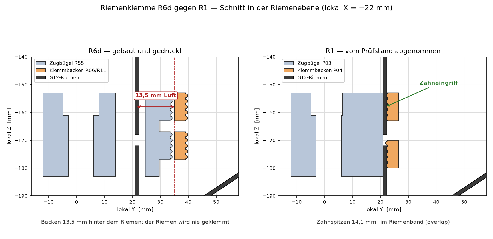
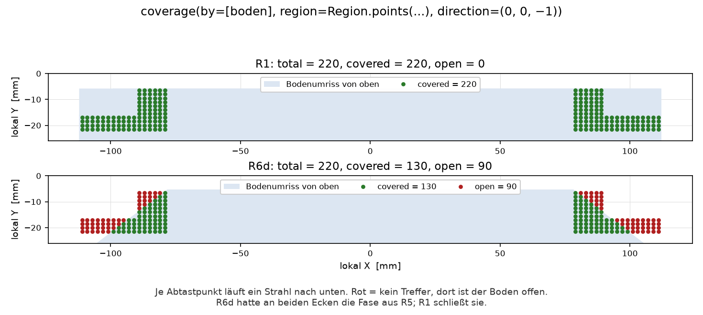

# Warum es den Prüfstand gibt

## Der Fall

Die Riemenklemme der Revision R6d war konstruiert, exportiert, gesliced und gedruckt.
Am Bildschirm sah sie richtig aus: Zugbügel, zwei Klemmbacken, vier M3-Schrauben, der
GT2-Riemen läuft durch. Auf dem Tisch hat sie nichts geklemmt.

Die Backen saßen 13,5 mm hinter dem Riemen.



Links der gedruckte Stand R6d, rechts die geprüfte Revision R1. Beides ist derselbe
Schnitt durch dieselbe Ebene (lokal X = −22 mm), gleicher Maßstab, gleicher Ausschnitt.
Das Riemenband liegt bei lokal Y 20,94 bis 22,30. Die Zahnspitzen der neuen Backe P04
reichen bis Y 21,6, also mitten hinein. Die Zahnspitzen der alten Backen R06/R11 beginnen
erst bei Y 35,1. Der rote Maßpfeil links spannt genau diese beiden Zahnspitzenlagen auf:
35,1 − 21,6 = 13,5 mm. Der Riemen wird nie berührt.

Rechts greifen die Zähne der Backe P04 in das Riemenband. Der Prüfstand misst dafür
14,075 mm³ gemeinsames Volumen je Backe.

## Warum das niemand gesehen hat

Auf dem Bildschirm steht man nie genau senkrecht auf der Riemenebene. Die Baugruppe ist
um 25° gekippt, die Backen sind orange, der Riemen ist dunkel, und aus jeder Perspektive,
in der man das Ganze im Blick hat, liegen beide scheinbar übereinander. Man sieht keine
13,5 mm Lücke, man sieht zwei Teile, die zusammengehören.

Ein Mensch prüft so etwas, indem er hinschaut. Hinschauen liefert keine Zahl.
Der Prüfstand liefert eine Zahl, und die Zahl war hier Null.

## Was das gekostet hat

Ein Druck und ein Tag. Nicht, weil der Druck lange dauert, sondern weil der Fehler erst
beim Zusammenbau auffiel und danach die Ursache gesucht werden musste: Ist der Riemen
falsch eingelegt? Ist die Schraube zu kurz? Sitzt der Bügel verkehrt? Erst die
Nachmessung im CAD hat den Abstand gezeigt.

## Was der Prüfstand daraus macht

Ein Test, drei Zeilen, der in unter vier Sekunden läuft:

```python
@pytest.mark.parametrize('name', VARIANTEN)
def test_backen_greifen_in_den_riemen(teile, machine, name):
    """Nominaler Zahneingriff der Backen in das ungezahnte Riemenband: rund 14 mm³ je Backe."""
    ...
    for jaw in jaws:
        r = overlap(belt, jaw)
        assert r.collides, r
        assert 13.0 <= r.volume_mm3 <= 15.0, r
```

Der Test läuft gegen zwei Varianten: `R1` (die neue Klemme) und `R6d` (die gedruckte).
`R6d` ist als `xfail(strict=True)` markiert. Das heißt: der alte Fehler **muss** rot
bleiben. Wäre er es eines Tages nicht mehr, würde der Testlauf scheitern — weil dann
entweder die Messung kaputt ist oder jemand die Referenzgeometrie verändert hat.

Der Lauf sagt dazu heute:

```
  passed test_backen_greifen_in_den_riemen[R1] overlap(volume_mm3=14.07504, collides=1, exact=1) ...
 xfailed test_backen_greifen_in_den_riemen[R6d] overlap(collides=0, exact=0, contacts=0)
```

`collides=0` bei R6d ist der Fehler von damals, festgehalten als Zahl.

## Der zweite Fall: der Hopperboden

Dieselbe Geschichte in anderer Form. Der Boden der Vorgängerrevision hatte an beiden
Vorderecken noch die Fase aus R5. Von oben gesehen fehlte dort Material, Teile konnten
neben den Wagen durchfallen. Auch hier war die Geometrie auf dem Bildschirm unauffällig:
eine Fase sieht immer wie eine gewollte Fase aus.



220 Abtastpunkte in den beiden Eckzonen, je ein Strahl von oben nach unten. R1 fängt
alle 220 Punkte ab. R6d lässt 90 durch. Auch dieser Fall steht heute als `xfail`
im Testlauf und darf nicht grün werden.

## Die Regel dahinter

Ein Teil ist nicht fertig, weil es aussieht wie fertig. Es ist fertig, wenn die
Messwerte stimmen, die man vorher aufgeschrieben hat — und wenn die Fehler, die man
schon einmal gemacht hat, nachweislich immer noch rot sind.

Weiter: [konzepte.md](konzepte.md) erklärt die Begriffe, mit denen diese Messungen
formuliert werden.
